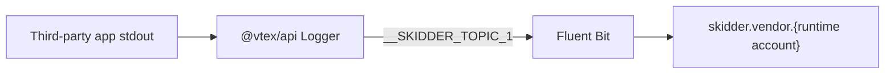

# Key Skidder topics by runtime account

> **Status**: Draft
> **Created**: 2026-11-17
> **Jira**: [VSC-1258826](https://vtex-dev.atlassian.net/browse/VSC-1258826)
> **Repository**: [vtex/node-vtex-api](https://github.com/vtex/node-vtex-api) (`master` / `7.x` and `6.x`)

## 1. Business Context

### Problem Statement

Third-party VTEX IO apps log to stdout through `@vtex/api`. For those apps the logger stamps two Kafka topic names on the JSON line: `skidder.vendor.{vendor}` and `skidder.app.{vendor}.{app}`. `{vendor}` is `APP.VENDOR`, the account that owns the app, not the account where the app is running. Fluent Bit publishes the line to those names unchanged.

Skidder then serves `GET /{account}/{workspace}/logs/stream` from `skidder.vendor.{account}`. A stream opened on the vendor account therefore contains every installation of that app. [VSC-1258826](https://vtex-dev.atlassian.net/browse/VSC-1258826) reports that behavior: an app such as `acme.orders-feed`, running in another store, is written into `skidder.vendor.acme`. The same stamp exists on `master` and on `6.x`.

The JSON already carries the runtime account and workspace (`account`, `workspace`). Only the topic name is wrong.

### Goals

- A third-party log line is routed to `skidder.vendor.{runtime account}` and `skidder.app.{runtime account}.{app name}`.
- Those names match the topics Skidder already subscribes to for the account in the URL.
- Lines produced in account A stop being written into the vendor account's topic, once the app runs this version of `@vtex/api`.
- The `account` and `workspace` fields on the JSON stay as they are.
- First-party apps (`vtex`, `gocommerce`) stay out of the Skidder topics.

### User Stories

#### US-1: Publish a line to the account that produced it

- **Story**: As a store developer, I want logs from an app running in my account to be written to my account's Skidder topic, so that a vendor stream is not the bucket for every store that installed the app.
- **Acceptance Criteria**:
  - **Given** a third-party app whose vendor is `acme` and whose name is `orders-feed`, running with `ctx.account` `storea`, **when** the app logs, **then** the stdout JSON has `__SKIDDER_TOPIC_1` equal to `skidder.vendor.storea` and `__SKIDDER_TOPIC_2` equal to `skidder.app.storea.orders-feed`.
  - **Given** the same app running with `ctx.account` `acme`, **when** the app logs, **then** both topic names use `acme`, not another account.
  - **Given** a log line produced by this version, **when** Fluent Bit reads `__SKIDDER_TOPIC_1` and `__SKIDDER_TOPIC_2`, **then** it publishes to those names without rewriting them.

#### US-2: Keep first-party logs off Skidder topics

- **Story**: As a platform operator, I want apps whose vendor is `vtex` or `gocommerce` to keep their current logging behavior, so that this change does not start publishing first-party stdout into Skidder.
- **Acceptance Criteria**:
  - **Given** `APP.VENDOR` is `vtex` or `gocommerce`, **when** the app logs, **then** the stdout JSON has no `__SKIDDER_TOPIC_1` and no `__SKIDDER_TOPIC_2`.
  - **Given** any app, **when** the app logs, **then** the JSON still has top-level `account` and `workspace` from the logger context.

#### US-3: Do not invent a topic when the account is missing

- **Story**: As a security reviewer, I want a line without a runtime account to stay out of Skidder, so that it cannot fall into a shared or malformed topic.
- **Acceptance Criteria**:
  - **Given** a third-party app and a logger context whose `account` is empty or missing, **when** the app logs, **then** the stdout JSON has no `__SKIDDER_TOPIC_1` and no `__SKIDDER_TOPIC_2`.
  - **Given** that line, **when** it is logged, **then** the call does not throw.

### Key Scenarios

| Scenario | Pre-conditions | Steps | Expected Result |
|---|---|---|---|
| Store installation | Vendor `acme`, app name `orders-feed`, `ctx.account` `storea`, `ctx.workspace` `master`. | Call `Logger.log`. | `__SKIDDER_TOPIC_1` is `skidder.vendor.storea`. `__SKIDDER_TOPIC_2` is `skidder.app.storea.orders-feed`. `account` is `storea`. `workspace` is `master`. |
| App running in the vendor account | Same app, `ctx.account` `acme`. | Call `Logger.log`. | Both topic names use `acme`. |
| First-party app | `APP.VENDOR` is `vtex`. | Call `Logger.log`. | No `__SKIDDER_TOPIC_*` fields. `account` and `workspace` are still present. |
| Missing account | Third-party app, `ctx.account` is `""`. | Call `Logger.log`. | No `__SKIDDER_TOPIC_*` fields. The call returns. |
| Old process still running | An app container built with the previous `@vtex/api`. | The app logs after this library is published. | The line still uses `skidder.vendor.{vendor}` until that app is rebuilt with this version. |

### Functional Requirements

1. On `master` and on `6.x`, a third-party log sets `__SKIDDER_TOPIC_1` to `skidder.vendor.{account}` and `__SKIDDER_TOPIC_2` to `skidder.app.{account}.{app name}`, where `{account}` is the logger context account and `{app name}` is `APP.NAME`.
2. `APP.VENDOR` is not part of either topic name.
3. `account` and `workspace` on the JSON are unchanged.
4. `__VTEX_IO_LOG` and the rest of the line shape are unchanged.
5. Vendors `vtex` and `gocommerce` do not receive Skidder topic fields.
6. An empty or missing account does not receive Skidder topic fields and does not throw.
7. The library does not also write the old vendor topic. One line has one pair of topic names.

### Non-Functional Requirements

- Publishing `@vtex/api` does not by itself restart running apps. The new names apply only after an app depends on this version and is redeployed.
- The change is covered by a unit test on the logger for both a third-party account and a first-party vendor.
- No new runtime dependency.

### Out of Scope

- Filtering records inside Skidder. That is a separate change in the Skidder repository. This library change does not remove lines already stored in `skidder.vendor.{vendor}`.
- Putting `workspace` in the topic name. Skidder subscribes to `skidder.vendor.{account}` and `skidder.app.{account}.{app}` with no workspace segment. A new segment would make new lines invisible to the current Skidder.
- Replaying or deleting history in Kafka.
- Changing Fluent Bit, Fluentd, or Skidder's subscription names.
- Dual-writing the old vendor topic and the new account topic.
- Forcing every installed app to bump `@vtex/api`. Adoption follows each app's release.

---

## 2. Arch Decisions

### Proposed Solution

Change the two topic strings in `Logger.log` on both supported lines. The runtime account is already on the logger. Fluent Bit already routes by `__SKIDDER_TOPIC_1` and `__SKIDDER_TOPIC_2`, so the library is the only producer change.



Today the middle arrow uses `APP.VENDOR`. After this change it uses `ctx.account`.

### Architecture Overview

`Logger` builds one JSON object and writes it with `console.log`. For a third-party vendor it adds the two topic fields before that write. Fluent Bit's Skidder output uses those fields as the Kafka topic key and does not derive a topic from the container. Skidder subscribes to `skidder.vendor.{url account}` and `skidder.app.{url account}.{app}`. Using the runtime account in the same pattern makes a new line land on the topic Skidder already opens for that account.

`master` and `6.x` both `console.log` this object. The edit is the same in both files. They are not the same commit: `6.x` is a release branch.

### Alternatives Considered

| Alternative | Pros | Cons | Verdict |
|---|---|---|---|
| Replace `APP.VENDOR` with the runtime account in both topic names | Matches the topic Skidder already reads. One string change per line. New lines stop joining the vendor bucket. | Does nothing until each app redeploys. History stays in the old topic. Workspace stays mixed inside the account topic. | Accepted. |
| Keep `APP.VENDOR` and let Skidder filter the stream | Closes the HTTP response immediately, including history, in one service. | Leaves the producer writing every store into the vendor topic. Any other Kafka reader still sees the mix. | Rejected as the change in this repository. It remains the right change in Skidder and complements this one. |
| Add `workspace` to the topic name | Separates `master` and `dev` in Kafka. | Current Skidder does not subscribe to that name, so new logs disappear from `vtex logs` until Skidder changes too. | Rejected. |
| Dual-write vendor topic and account topic | Old Skidder consumers keep receiving lines during a migration. | The vendor topic keeps receiving other accounts' lines, which is the bug. | Rejected. |
| Move lines that are already in `skidder.vendor.{vendor}` | Would clean history for every consumer. | This library cannot rewrite Kafka. | Rejected. |

### Risks & Mitigations

| Risk | Impact | Likelihood | Mitigation |
|---|---|---|---|
| Apps stay on the old `@vtex/api` and keep filling `skidder.vendor.{vendor}` | High | High | State in the release note that a redeploy is required. The Skidder response filter covers old and new lines on the HTTP stream. |
| History in the vendor topic is still readable | High | High | Out of scope here. Retention expires it. The Skidder filter hides it from the HTTP stream before that. |
| `ctx.account` is empty and a topic is created for a blank name | Medium | Low | Omit both topic fields when the account is empty. Do not throw. |
| `6.x` and `master` diverge and only one line is fixed | Medium | Medium | The same assertion ships on both branches. This spec's implementation is two pull requests, one per line. |
| A client opens `logs/stream/{app}` with a path that is not `APP.NAME` | Low | Low | The app suffix stays `APP.NAME`, which is the suffix the producer uses today. Only the account segment changes. |

### Key Decisions

#### Decision 1: Topic account is the runtime account

- **Status**: Accepted
- **Context**: `APP.VENDOR` groups every installation of an app into one topic. The logger already knows the account of the current context.
- **Decision**: `__SKIDDER_TOPIC_1` is `skidder.vendor.{ctx.account}`. `__SKIDDER_TOPIC_2` is `skidder.app.{ctx.account}.{APP.NAME}`.
- **Consequences**: A new line from a store no longer enters the vendor account's topic. Skidder's current subscription name starts matching that line when the URL account is the store. The vendor's own stream only receives lines produced while the app ran in the vendor account.

#### Decision 2: No second write to the vendor topic

- **Status**: Accepted
- **Context**: Writing both names would keep the cross-account leak for every upgraded app.
- **Decision**: Each line carries one pair of topic fields. The vendor-keyed names are removed.
- **Consequences**: During adoption, old processes write the old names and new processes write the new names. There is no period where a new process feeds both.

#### Decision 3: Workspace stays a JSON field

- **Status**: Accepted
- **Context**: The record already has `workspace`. Skidder's topic name has no workspace segment.
- **Decision**: This change does not put workspace in `__SKIDDER_TOPIC_1` or `__SKIDDER_TOPIC_2`.
- **Consequences**: Workspaces of the same account still share a topic. Separating them is a Skidder subscription change, not a library-only change.

#### Decision 4: Ship on `master` and `6.x`

- **Status**: Accepted
- **Context**: Both lines stamp `APP.VENDOR` and both print the JSON to stdout.
- **Decision**: The source change lands on `master` and is repeated on `6.x`. This document is the spec for both. The pull request that adds the spec targets `master`.
- **Consequences**: Two implementation pull requests. An app on `6.x` is not fixed by a `7.x` publish.

### Implementation Plan

1. Add a unit test that a third-party logger with account `storea` emits `skidder.vendor.storea` and `skidder.app.storea.{APP.NAME}`, that `vtex` emits neither topic field, and that an empty account emits neither topic field.
2. Change `Logger.log` on `master` so the topic strings use the context account. Keep the `IS_THIRD_PARTY` guard.
3. Open the same change against `6.x`.
4. Publish the two lines. Call out in the release note that installed apps pick this up on their next release, and that lines already in Kafka are unchanged.

---

## 3. Technical Contract

### Data Models

**Runtime account.** `LoggerContext.account`, already copied to `Logger.account` and to the JSON property `account`. It is the account where the app is handling the current work. It is not `APP.VENDOR`.

**Topic fields.** Present only when `APP.IS_THIRD_PARTY()` is true and the runtime account is a non-empty string.

| Field | Value |
|---|---|
| `__SKIDDER_TOPIC_1` | `skidder.vendor.{runtime account}` |
| `__SKIDDER_TOPIC_2` | `skidder.app.{runtime account}.{APP.NAME}` |

`APP.NAME` stays the app name segment used today. No workspace segment is added.

**Unchanged properties.** `__VTEX_IO_LOG`, `level`, `app`, `account`, `workspace`, `production`, `data`, `operationId`, `requestId`, and the optional `traceId` stay on the object with their current meaning.

### Interfaces

`Logger.log`, `debug`, `info`, `warn`, and `error` keep their signatures. The observable change is the two string values inside the JSON written to stdout.

No HTTP route, event contract, or exported type changes.

A third-party line with account `storea` and app name `orders-feed` includes:

```json
{
  "account": "storea",
  "workspace": "master",
  "__SKIDDER_TOPIC_1": "skidder.vendor.storea",
  "__SKIDDER_TOPIC_2": "skidder.app.storea.orders-feed"
}
```

A first-party line, and a third-party line with an empty account, omit `__SKIDDER_TOPIC_1` and `__SKIDDER_TOPIC_2`.

### Integration Points

- **Fluent Bit.** Reads `__SKIDDER_TOPIC_1` and `__SKIDDER_TOPIC_2` as topic keys. No chart change is required for the new names to be published.
- **Skidder.** Already subscribes to `skidder.vendor.{account}` and `skidder.app.{account}.{app}` using the account from the URL. New lines become visible on the stream of the runtime account. Lines previously written under `skidder.vendor.{vendor}` stay there.
- **App build.** `@vtex/api` is bundled by each VTEX IO app. The running container uses the version it was published with.

### Invariants & Constraints

- A third-party line with a non-empty runtime account carries both topic fields, and both use that account.
- `APP.VENDOR` does not appear in either topic field.
- A line never carries the old vendor-keyed topic and the new account-keyed topic together.
- Vendors `vtex` and `gocommerce` do not carry Skidder topic fields.
- An empty runtime account does not carry Skidder topic fields, and logging still returns.
- `workspace` remains a JSON property and is not part of the topic name.
- This contract applies to the stdout JSON of `Logger` on `master` and on `6.x`.
