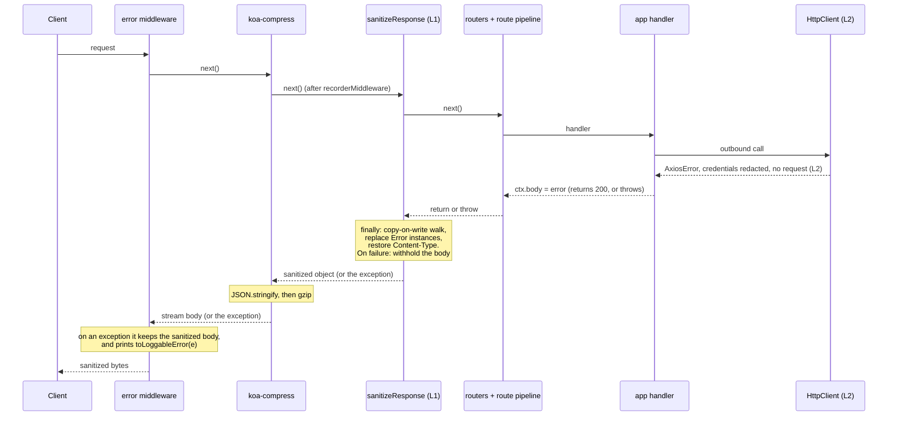

# Sanitize credential-bearing HTTP responses (two layers)

> **Status**: Draft (v3: incorporates the security review of this PR; iteration 1 is implemented, see "Implementation Plan")
> **Created**: 2026-11-06

## 1. Business Context

### Problem Statement

A VTEX IO Node app can catch an outbound HTTP failure and assign the raw error to the response body, then return normally: `catch (e) { ctx.body = e }`. On a public route this needs no authentication. The body is the Axios error serialized through `AxiosError.prototype.toJSON()`: `message`, `name`, `stack`, and `config`. `config.headers` carries the app credential (`proxy-authorization`, copied from `x-vtex-credential`) and other VTEX headers; the stack carries internal paths; agent options leak runtime internals. A caller can trigger the failure with a malformed query parameter and receive a fresh app token on every request.

The existing global handler (`src/service/worker/runtime/http/middlewares/error.ts`) cannot see this. It only runs inside `try { await next() } catch`, and a handler that swallows the exception returns on the success path. On the way out, `koa-compress` (3.x) runs `ctx.body = JSON.stringify(body)`, which calls the error's `toJSON()` and writes `config.headers` into the response.

The review of this spec found three more places where a raw error leaves the process, and one failure mode of the proposed middleware:

- **Throw path.** If the handler sets the tainted body and then throws, or the sanitizer itself throws, the `error` middleware keeps the existing body (`ctx.body = ctx.body || err`).
- **Process output.** `error.ts` prints the raw error with `console.error` before `cleanError`, and `util.inspect` shows `config.headers` at its default depth. The process listeners do the same for uncaught exceptions and unhandled rejections.
- **GraphQL.** `errors[].stack` is part of the response in production.
- **Text bodies.** `ctx.body = JSON.stringify(error)` is exempt from any walk.

### Design stance

This is a backstop for naive apps that return errors by mistake. It is not a security boundary against a malicious tenant app, which already holds its own `authToken` and can send it anywhere. Residual paths that are not covered are listed under "Out of Scope".

### Verified runtime facts

| Fact | Evidence |
|---|---|
| The pod is the `service-node` image: a Go binary downloads the bundle to `./service` and runs `node lib/index.js` with `NODE_ENV=production`. | `service-runtime-node/main.go`, `Dockerfile` |
| `lib/index.js` calls `smartRequire('@vtex/api').startApp()`. Without `VTEX_APP_LINK` it resolves the runtime's copy; with it, the developer's copy (`appPath`). | `src/index.ts`, `src/smartRequire.ts` |
| **Which image runs an app depends on its `manifest.json` `builders.node` major.** `6.x` runs `IO_SERVICE_NODE_V6` (6.42.4), built from the `6.x` branch of `service-runtime-node`, which pins **`@vtex/api` 6.52.1** (Node 16, axios `^0.30.1` in `node-vtex-api`'s `6.x`). `7.x` runs `IO_SERVICE_NODE_V7` (7.8.0), built from `master`, which pins `@vtex/api` 7.6.0 (Node 20, axios `^1.8.4`). `V4` and `V5` pin `@vtex/api ^3.x`. | `charts/io/platform/values.yaml` (lines 44–63); `package.json` on each branch |
| The app's own `import … from '@vtex/api'` resolves to the image's copy when the bundle does not ship one. The Dockerfile links `/usr/local/node_modules/@vtex` at `/usr/local/app/node_modules/@vtex`, and the bundle lives at `/usr/local/app/service/src/node/`. | `Dockerfile`, `src/service/loaders.ts` |
| `builder-hub` pins `@vtex/api` only for typings (`pinnedDependencies.ts`) and no builder step removes it from `dependencies`. The 2020 changelog says "Uses @vtex/api from runtime for node 6.x". So an app that lists `@vtex/api` under `dependencies` may carry its own copy. Not verified. | `builder-hub/CHANGELOG.md`, `node/request/handlers/pinnedDependencies.ts` |
| A leaked response proves the image's client served the call: the stack frames sit under `/usr/local/app/node_modules/axios`, and `httpAgent` shows `freeSocketTimeout 30000`, `maxFreeSockets 256`, `socketActiveTTL 120000`, the values in `src/HttpClient/agents.ts`. | captured response; `agents.ts` |
| Token source: `prepareHandlerCtx` sets `ctx.vtex.authToken` from `x-vtex-credential`. `ExternalClient` puts it in `Proxy-Authorization`. `defaultsMiddleware` lower-cases header names. | `utils/context.ts`, `clients/external/ExternalClient.ts`, `HttpClient/middlewares/request/index.ts` |
| Koa pipeline on both lines: `error → … → compress() → recorderMiddleware → public router → private router → route pipeline → app handlers`. GraphQL is built on `createPrivateHttpRoute`. | `src/service/worker/index.ts` on `master` and `origin/6.x` |
| The child Node process receives only an env whitelist (`runner/command.go` `envWhitelist`) plus `envVars` in `service-runtime-node/main.go`. A new env var reaches the app only if added there. | `service-runtime-base/runner/command.go`, `main.go` |
| **The leak reproduces end to end** with `koa-compress` 3.0.0 and axios 1.8.4 on `master`: an axios error assigned to `ctx.body` comes out of a gzip response with the `proxy-authorization` token, `config` and `httpAgent`. | control tests in `sanitizeResponse.test.ts` and `responseSanitizer.test.ts` |
| Koa 2.11 sets `Content-Type: application/json` whenever an object is assigned to the body, replacing a type set earlier. | `node_modules/koa/lib/response.js`; test "keeps the content type chosen by the app" |
| `util.inspect` of an axios error at its default depth prints the `Proxy-Authorization` value. `error.ts` calls `console.error('[node-vtex-api error]', e)` on the raw error, and `listeners.ts` does the same for `uncaughtException` and `unhandledRejection` (also printing the `promise`, which shows the reason again). Whether process output reaches a shared log sink is **not verified**. | `error.ts`, `listeners.ts`; test "prints the raw error with the credential" |
| `ERROR_FIELD_WHITELIST` in the GraphQL error utils includes `stack`. The GraphQL error middleware deletes `extensions.exception.sensitive` after logging, but not `stack`. For errors reported by the GraphQL engine (`formatApolloErrors`) the stack is not carried over, so the exposure is on the thrown-error path. | `graphql/utils/error.ts`, `graphql/middlewares/error.ts`; tests in `graphql/middlewares/error.test.ts` |
| `cleanError` / `destroyCircular` copies its `seen` list per path and has no depth or size limit. It also expands class instances and buffers key by key. | `src/utils/error.ts` |
| The store cookie is named `VtexIdclientAutCookie_<account>`, which an exact-name match on `vtexidclientautcookie` misses. | review, confirmed by the reviewer |

### Goals

- No HTTP response of a production Node app contains the app token, credential headers of upstream calls, Node `request`/agent objects, or a stack, on the success path and on every throw path.
- No raw error with its request config is written to the process output.
- The fix reaches installed apps without rebuilding them, on every runtime line that serves them, through a runtime release.
- Preserve what the app returns: remove only sensitive fields. No status or general shape changes, except when the body has to be withheld.
- Make remaining leaks visible so owners can be notified, and so the scope of exposure can be measured.

### User Stories

#### US-1: Caught HTTP-client error written to the body

- **Story**: As a platform operator, I want an error object assigned to `ctx.body` to leave the pod without credentials, agent internals, or a stack, so that a tenant app cannot leak the app token.
- **Acceptance Criteria**:
  - **Given** a route whose handler sets `ctx.body` to an Axios error and does not throw, **when** the response is produced in a non-linked runtime, **then** `JSON.stringify` of the body contains no token, `config`, `request`, `httpAgent`/`httpsAgent`, upstream response headers or `stack`, keeps `name`, `message`, `code`, `status`, and `ctx.status` is unchanged.
  - **Given** a handler that sets the error as the body and then throws, **when** the request ends, **then** the body the `error` middleware keeps is the sanitized one, and the exception still reaches that middleware.
  - **Given** a runtime where the code applies and `VTEX_APP_LINK` is set, **when** the response is produced, **then** `stack` stays and the config, request and agents are still removed.

#### US-2: Nested and hand-built bodies (iteration 2)

- **Story**: As a platform operator, I want credentials removed at any depth of an object body, and from text bodies, so that `ctx.body = e.toJSON()`, hand-copied header objects and `JSON.stringify(e)` are covered.
- **Acceptance Criteria**:
  - **Given** a credential-header key inside an object reached through a `headers` key, **when** the response is produced, **then** its value is `[REDACTED]`. The same key anywhere else is left alone.
  - **Given** a string body, a string value, or a UTF-8 buffer with a textual or JSON content type, that contains a known secret of 16 or more characters, **when** the response is produced, **then** each occurrence becomes `[REDACTED]` (exact substring, `split`/`join`) and the rest is unchanged. Streams are not touched.
  - **Given** `{ token: 'abc', cookie: 'consent=1', authorization: { status: 'approved' } }`, **when** the response is produced, **then** the body is unchanged.

#### US-3: Ordinary responses and thrown errors keep working

- **Story**: As an app developer, I want unaffected responses and thrown errors to behave as before.
- **Acceptance Criteria**:
  - **Given** a body with no `Error` instance (and, from iteration 2, no credential key under `headers` and no secret), **when** the handler returns, **then** `ctx.body` is the same reference and the `Content-Type` header is unchanged (including a non-default JSON type). `Error` instances become plain objects by design: that is the change.
  - **Given** a body that is a stream, a `Buffer`, or `null`, **when** the response is produced, **then** it is untouched in iteration 1.

#### US-4: The error is safe at its origin (iteration 3)

- **Story**: As a platform operator, I want the error to reach app code without credentials, so that logging it, persisting it, or putting it in an event cannot leak them.
- **Acceptance Criteria**:
  - **Given** an `HttpClient` call that fails with HTTP 400, **when** the app catches the error, **then** the values of credential headers on `config.headers` (by exact name, by the `vtexidclientautcookie` prefix, and by the name patterns in Decision 4) and `config.auth` are `[REDACTED]`, secret-named keys in `config.params` and in the query of `config.url` are `[REDACTED]`, `request` and `response.request` are `undefined`, and `response.status` and `response.data` are intact.
  - **Given** a call that fails with 503 twice and then succeeds, **when** retries run, **then** every attempt sent the real header and the call succeeds.

#### US-5: Operability

- **Story**: As an on-call engineer, I want to see which apps trigger redactions, why, and to switch the response layer off.
- **Acceptance Criteria**:
  - **Given** a redaction, a limit hit or a sanitizer failure, **when** it happens, **then** a warn log with a `reason` code (`error_object_removed`, `limit_reached`, `sanitizer_failed`), the route id, and a count is written, never the value or the body. The logger adds account and workspace, so exposure can be queried per tenant (Decision 6).
  - **Given** `VTEX_IO_RESPONSE_SANITIZER=off`, **when** a request is served, **then** the response layer does nothing. The origin layer has no switch.
  - **Given** an exception inside the sanitizer, **when** it occurs, **then** the body is **withheld**: replaced by `{ code: 'E_RESPONSE_WITHHELD', message }`, with status 500 if the status was below 400, and the failure is logged (fail-closed).

#### US-6: No raw error on the process output

- **Story**: As a platform operator, I want errors printed by the runtime to carry no request config or credentials, so that process logs cannot leak them.
- **Acceptance Criteria**:
  - **Given** a handler that throws an axios error, **when** the `error` middleware prints it, **then** the printed value contains no token, `config`, `httpAgent`, but still the error name, message, stack and its other properties, and is printed as an error.
  - **Given** an uncaught exception or an unhandled rejection, **when** the process listeners print it, **then** the same holds, and the promise is not printed.

#### US-7: No stack in GraphQL responses

- **Story**: As a platform operator, I want GraphQL errors in production to carry no stack, as REST errors do.
- **Acceptance Criteria**:
  - **Given** a resolver that throws in a non-linked runtime, **when** the response is produced, **then** `errors[]` has no `stack`, no `extensions.exception.sensitive`, and the logged error still has its stack.
  - **Given** a linked runtime, **when** the response is produced, **then** `stack` stays.

### Key Scenarios

| Scenario | Pre-conditions | Steps | Expected Result |
|---|---|---|---|
| Caught error, gzip client | Non-linked. Handler sets `ctx.body = axiosError`, returns 200. | `GET` with `Accept-Encoding: gzip`. | Plain body without token, `config`, `request`, agents, `stack`; has `name`, `message`, `code`, `status`, `response.{status, statusText, data}`. Status 200. Gzip applied. |
| Nested errors | Body is `{ error: e }`, `[e]`, or `{ errors: [{ extensions: { exception: e } }] }`. | Return normally. | Every `Error` replaced by its safe form. Sibling fields intact. |
| Throw after body set | Handler sets `ctx.body = e`, then throws, with the real `error` middleware in front. | Request ends. | Status 500, body sanitized, no token. |
| Sanitizer fails | The body holds an error and a getter that throws. | Return normally; and with a handler that throws afterwards. | Status 500 (or the error status the app chose), body `E_RESPONSE_WITHHELD`, no token, `sanitizer_failed` logged. |
| Limit reached | Body deeper than 32 or over 200,000 objects. | Return normally. | The rest is not inspected, the response is sent, `limit_reached` logged. Inside an error the rest is replaced by `[Truncated]`. |
| Error with hostile data | Error whose details have 20,000 levels, shared references with 2^40 paths, a `Buffer`, a class instance, a self-reference. | Return normally. | Bounded work, markers (`[Truncated]`, `[Buffer 3 bytes]`, `[ClassName]`, `[Circular]`), never the received error. |
| Stringified error (iteration 2) | `ctx.body = JSON.stringify(e)`. | Return normally. | Known token replaced by `[REDACTED]`. |
| Lookalikes (iteration 2) | `{ cookie: 'consent=1', authorization: { status: 'approved' } }`, 5,000-product list. | Return normally. | Same reference, same `Content-Type`. |
| Credential key under `headers` (iteration 2) | `{ config: { headers: { 'proxy-authorization': 'x', 'VtexIdclientAutCookie_acme': 'y' } } }`. | Return normally. | Both values `[REDACTED]`. |
| Frozen or shared body | App returns a frozen or module-cached object holding an error. | Two requests. | The app's object is not mutated; each response is sanitized. |
| Typed arrays, Maps, Sets | Body holds them. | Return normally. | Not walked; same reference. |
| No `ctx.vtex` | Unknown route, router 404. | Return an error body. | Sanitized; the log goes to the console. |
| Kill switch | `VTEX_IO_RESPONSE_SANITIZER=off`. | Any request. | Response layer does nothing. |
| Process output | A handler throws an axios error. | The `error` middleware logs it. | Printed without credentials, with stack and properties. |
| GraphQL | A resolver throws, non-linked and linked. | `POST` the GraphQL route. | No `stack` in `errors[]` when non-linked, still logged. |
| HttpClient failure (iteration 3) | Upstream answers 400. | App catches and serializes or persists the error. | Credentials redacted, no `request`; `status` and `data` intact. |
| HttpClient retry (iteration 3) | Upstream fails twice with 503, then 200. | Call through `HttpClient`. | All attempts carry the real header; the call succeeds. |
| App ships its own `@vtex/api` | `@vtex/api` listed under `dependencies`. | Same failure as above. | Response layer applies; origin layer does not. |

### Functional Requirements

Response layer (Layer 1, iteration 1 for errors, iteration 2 for the rest):

- One Koa middleware at app level, registered after `recorderMiddleware` and before the routers (inside `compress()`), covering public, private, GraphQL, and built-in routes.
- `try { await next() } finally { sanitizeCtxBody(ctx) }`. It never throws and never changes `ctx.status`, except when it withholds the body.
- **Fail-closed**: if the walk throws, `ctx.body` becomes `{ code: 'E_RESPONSE_WITHHELD', message }` and the status 500 if it was below 400. If even that fails, the body is emptied.
- Walk plain objects and arrays with copy-on-write. A *plain object* is one whose prototype is `Object.prototype` or `null`. Buffers, typed arrays, `ArrayBuffer`, Maps, Sets, streams, dates and class instances other than errors are not walked.
- Replace `Error` instances (`types.isNativeError` or `instanceof Error`, which covers `AxiosError`) by their safe form: `name`, `message`, `code`, other enumerable own properties, `response.{status, statusText, data}`, and `stack` only when linked. Never `config`, `request`, `httpAgent`, `httpsAgent`, upstream response headers.
- **Bounded**: depth 32, 200,000 objects, cycle detection. Outside an error, what is beyond a limit is left as is and reported (`limit_reached`). Inside an error it is replaced by `[Truncated]`, because `cleanError` has no limits of its own. Inside an error, buffers and typed arrays become `[Name N bytes]`, dates ISO strings, class instances `[Name]`, a cycle `[Circular]`.
- Save and restore `Content-Type` around the reassignment of `ctx.body`.
- Skip `null`, strings, `Buffer` and streams (`typeof body.pipe === 'function'`) in iteration 1. From iteration 2, strings and UTF-8 buffers with textual or JSON content types get known-secret replacement; streams stay exempt.
- Iteration 2: redact credential-header keys only inside objects reached through a `headers` key; secrets by value.

Process output:

- `toLoggableError(value)` returns the value with every `Error` replaced by its safe form with the stack kept, rebuilt on the original prototype so it prints as an error. It never throws; on failure it returns a fixed marker.
- Used by the `error` middleware (`console.error('[node-vtex-api error]', …)`) and by the `uncaughtException` and `unhandledRejection` listeners, which no longer print the promise.

GraphQL:

- In the GraphQL error middleware, after logging and when not linked, delete `stack` from each error of the response, besides `extensions.exception.sensitive`.

Origin layer (Layer 2, iteration 3):

- In `requestMiddleware` (`src/HttpClient/middlewares/request/index.ts`), wrap `http.request` and throw `sanitizeHttpClientError(err)`.
- Redact values, keeping the keys: credential headers on `err.config.headers` (exact names, the `vtexidclientautcookie` prefix, and names matching `/auth|token|key|secret|cookie|credential|session|password/i`); `err.config.auth`; secret-named keys in `err.config.params` and in the query of `err.config.url`.
- Delete `err.request` and `err.response.request`. They cannot be stripped: the serialized header block (`_header`) stays, `removeHeader` throws after sending, and an instance-level `toJSON` does not affect `util.inspect`, spread or `Object.entries`.
- Do not touch `stack`, `message`, `code`, `response.status`, `response.data`, or `config.data` (see Open Questions).
- Must behave the same on axios `0.30.x` (plain headers object) and `1.x` (`AxiosHeaders`).

Shared:

- One exported `SENSITIVE_HEADER_KEYS` constant, used by Layer 2 and by the thrown-error path in `cleanError`, replacing its three hard-coded names (iteration 3).
- No API newer than Node 16: the `6.x` line ships on Node 16.20.2.

### Non-Functional Requirements

- **Measured cost of the walk** (Node 22, one core, median of 5, plain catalog-like JSON; `JSON.stringify` of the same body for reference). To be repeated in the Developers cluster:

  | Body | Objects | Walk | `JSON.stringify` |
  |---|---|---|---|
  | 0.09 MB | 2,900 | ~1 ms | 0.1 ms |
  | 0.94 MB | 29,000 | ~8 ms | 1.4 ms |
  | 4.7 MB | 145,000 | ~46 ms | 7.8 ms |
  | 19 MB | 580,000 | 61 ms with the default cap (truncated); 176 ms without it | 31 ms |

  The walk is about 6 times `JSON.stringify` and blocks the event loop. The 200,000-object cap bounds the worst case near 60 ms, and bodies above roughly 6 MB of typical JSON are only partly inspected (reported as `limit_reached`). See Open Questions 8.
- Never log the redacted value or the body.
- Logs carry a `reason` code so a query on the warn message gives route, tenant and reason (Decision 6).
- Optional Prometheus counter `vtex_io_credential_sanitizer_total{layer, reason, route_id}`; needs the metrics review required by the runtime repository.

### Out of Scope

- Fixing the tenant app. The owner still owns authentication and input validation for that route.
- Containment of credentials already exposed: token lifetime, revocation and rotation. A separate workstream; not verified here.
- Redacting at Janus or the router (rejected earlier for proxy cost).
- Changing status codes, or turning a 200 error into a 5xx (except when the body is withheld).
- Redacting `adminUserAuthToken`, `storeUserAuthToken`, `sessionToken` by default (see Open Questions).
- **Residual paths**: header sinks (`ctx.set`, `redirect`), bytes written directly to `ctx.res`, streams, a plain object that defines its own `toJSON`, third-party API keys and secrets from app settings (they are not known to the runtime), tokens that are split or re-encoded. Event handlers answer 204.
- Linked apps: with `VTEX_APP_LINK` set the entrypoint loads the developer's `@vtex/api`.
- Apps that bring their own axios or `node-fetch`: only Layer 1 and the process-output change (which is in the runtime's own `error` middleware) apply.
- Runtime lines `V4`/`V5` unless the decision in Open Questions says otherwise.

---

## 2. Arch Decisions

### Proposed Solution

Two independent layers, released together on each runtime line that serves apps, plus two small changes where raw errors leave the process:

1. **Layer 1, response sanitizer**: an app-level Koa middleware that cleans `ctx.body` on the way out, before `compress()` serializes it, and fails closed.
2. **Layer 2, origin hardening**: `HttpClient` redacts credentials on the error before app code sees it.
3. **Process output**: errors printed by the runtime go through the same safe form.
4. **GraphQL**: no `stack` in production responses.

Layer 1 closes the incident class (any app that writes an error into the response). Layer 2 keeps the secret out of logs, Master Data documents, events, and GraphQL fields that the app fills from the error.

### Architecture Overview



`koa-compress` 3.x does `if (isJSON(body)) body = ctx.body = JSON.stringify(body)` and then swaps in a gzip stream. Registered after `compress()`, the sanitizer still sees the original object. `error` (outermost) would see the stream.

### Alternatives Considered

| Alternative | Pros | Cons | Verdict |
|---|---|---|---|
| Extend only the global `error` middleware | Reuses `cleanError` | Runs only on throws; sits outside `compress()` | Rejected for the response; used for the process output |
| Sanitizer at the outermost position | Would see thrown-error bodies | Sees the gzip stream; thrown errors are already cleaned | Rejected |
| Sanitizer inside each route pipeline, before `...middlewares` (v1) | Close to the handlers | Two copies to keep in sync; misses built-in and 404 routes; `ctx.vtex` required | Superseded by app-level placement |
| Remove the `ctx.body \|\|` fallback in `error`, or sanitize there | Closes the throw path in one place | `error` sits outside `compress()`; the fallback also serves legitimate bodies. The `finally` already runs before `error` sees the exception | Not needed: the throw path is closed by `try/finally` plus fail-closed |
| Fail-open on a sanitizer exception (v2) | Never breaks a response | Whatever made the walk throw can hide a credential, and the body goes out unchanged | Rejected; fail-closed |
| Withhold the body when a limit is reached | No uninspected part | Legitimate large responses (catalog pages above ~6 MB) would break | Rejected; log `limit_reached` and measure |
| Redact in `HttpClient` only | Fixes the source | Does not cover hand-built bodies, apps with their own `@vtex/api`, or other clients | Accepted as Layer 2, with Layer 1 |
| Override `toJSON` on the error | Smaller serialized error | Changes the object apps may inspect; does not affect `util.inspect`, spread or `Object.entries` | Rejected |
| In-place mutation of the body | No reassignment; fewer allocations | Mutates app-owned objects (cached, frozen, shared across requests) | Rejected; copy-on-write |
| `JSON.stringify` the body and search the text | Simple | Calls the error's `toJSON()` again, re-creating the leak shape; extra allocation | Rejected |
| Redact `token`/`auth`/`cookie` keys anywhere | Broader | Blanks legitimate payload keys | Rejected; only under a `headers` key |
| Turn an error body with status 200 into 5xx | Visible failure | Changes the app contract and caching | Rejected |
| Redact in an axios response interceptor instead of the `requestMiddleware` catch | Sees the error early | The retry interceptor reuses `error.config` to resend, so sanitizing before it breaks retries; one registered after it sees only the final rejection, like the catch | Catch kept; revisit if tracing needs the clean error |

### Risks & Mitigations

| Risk | Impact | Likelihood | Mitigation |
|---|---|---|---|
| **Fix lands only on `master`; the affected apps run `V6`, built from the `6.x` branch** | High: the leak stays live | High if unplanned | Backport to `node-vtex-api` `6.x` and release; bump `service-runtime-node` `6.x`; update `IO_SERVICE_NODE_V6` and `V7` (Decision 5) |
| Throw path keeps a tainted body | High | Closed in iteration 1 | `try/finally` plus fail-closed; tests with the real `error` middleware |
| Sanitizer exception leaks the body | High | Closed in iteration 1 | Fail-closed; mutation-checked test |
| A legitimate body makes the walk throw and is withheld | A broken response | Very low (throwing getters or proxies, which also break `JSON.stringify`) | `sanitizer_failed` logged with the route id; kill switch |
| Part of a large body is never inspected | A credential beyond the limit | Low | Reported as `limit_reached`; limits tied to the measured cost; open question 8 |
| `cleanError` expands untrusted data without limits | Time and stack depth | Low | The walk bounds what reaches it (depth, size, binary, class instances, cycles) |
| Raw errors printed by apps' own code or other libraries | Credentials on the process output | Medium | Out of reach of this change; confirm with the logging owners whether process output is shared (Open Question 9) |
| axios `0.30` and `1.x` differ (headers shape, `toJSON`) | Layer 2 or tests pass on one line only | Medium | Run the same tests on both lines; construct errors with the real axios of each line |
| Reassigning `ctx.body` resets `Content-Type` | Behavior change for custom JSON types | Closed | Verified in Koa 2.11; saved and restored; tested |
| Walk cost on large bodies | Event-loop latency | Medium | Measured (see Non-Functional Requirements); copy-on-write; caps; kill switch; repeat in Developers |
| An app returns `ctx.vtex.authToken` on purpose | Breaks that app | Low | Intended: backstop, not a boundary (design stance) |
| Substring match on a secret of 16+ characters (iteration 2) | False positive | Very low | Length floor; token-sized secrets |
| Third-party keys, settings secrets, split tokens | Bypass | Medium | Documented residual; not known to the runtime |
| `config.data` of the request stays on the error (Layer 2) | The app's own request body (for example a password) can be persisted | Low | Kept for debugging by default; Open Question 7 |
| App has its own `@vtex/api` or axios | Layer 2 does not apply | Medium | Layer 1 still applies |
| Kill switch unreachable in the pod | Cannot disable Layer 1 without a rollback | Medium | Add the env var to `envVars` in `service-runtime-node/main.go` and set it in the app-operator config |
| Layer 2 mutates `err.config` that something reuses | Wrong headers on a later attempt | Low | Redaction runs only on the final rejection; test that retries see the real header |

### Key Decisions

#### Decision 1: App-level placement inside `compress()`, with `try/finally`, failing closed

- **Status**: Accepted (replaces the per-route-pipeline placement of v1 and the fail-open of v2)
- **Context**: One middleware must cover public, private, GraphQL, and built-in routes, run before serialization, and still act when the handler set `ctx.body` and then threw. `error` keeps that body (`ctx.body = ctx.body || err`).
- **Decision**: `.use(sanitizeResponse)` right after `.use(recorderMiddleware)` in `startWorker`. Sanitize in `finally`. If the sanitizer throws, withhold the body (Functional Requirements) and log `sanitizer_failed` with the error name only.
- **Consequences**: One registration. Routes without `ctx.vtex` are covered. On any throw path the body is either sanitized or withheld. Invariant: **on any throw path `ctx.body` contains no error instance**; from iteration 2, no credential header value and no known token either.

#### Decision 2: Preserve status and shape; sanitize with copy-on-write

- **Status**: Accepted
- **Context**: Apps may return errors with 200 on purpose, and may hold bodies that are frozen or shared.
- **Decision**: Never change `ctx.status` (except to withhold). Rebuild only the paths that change. Restore `Content-Type` after reassigning. Keep `message`, `name`, `code`, `status`, `level`, and `response.status`/`statusText`/`data`.
- **Consequences**: Unchanged bodies keep their reference. App-owned objects are never mutated. Nested `Error` instances become plain objects, which is the intended change.

#### Decision 3: Detection and redaction rules

- **Status**: Accepted, in two iterations
- **Context**: Errors arrive as `Error` instances, as `toJSON()` output, or hand-built objects.
- **Decision**:
  - **Iteration 1, errors**: a node is an error if `types.isNativeError(node) || node instanceof Error`. Its safe form is built from a shallow copy that never contains `config`, `request`, `httpAgent`, `httpsAgent`, and goes through `cleanError`, after the walk has bounded what it carries.
  - **Iteration 2, the rest**:
    1. **Header key**: inside an object reached through a `headers` key, a key that equals one of `SENSITIVE_HEADER_KEYS` (case-insensitive) or starts with `vtexidclientautcookie` has its string value replaced by `[REDACTED]`. `authorization` only when the value starts with `Bearer ` or `Basic `.
    2. **Secret by value**: strings, and UTF-8 buffers with textual or JSON content types, that contain a known secret (`x-vtex-credential`, `ctx.vtex.authToken`; 16 or more characters; longest first) get each occurrence replaced, with `split`/`join`, not a pattern built from the token. Streams stay exempt.
    3. **Container**: recurse into own enumerable entries of plain objects and arrays.
- **Consequences**: Legitimate keys named `authorization` or `cookie` outside `headers` are untouched. An error-shaped plain object (for example `e.toJSON()`) is handled by rule 1, because its `config` leads through `headers`, not by shape detection. A plain object with its own `toJSON` is walked as data and may hide a secret (residual).

#### Decision 4: Origin hardening in `requestMiddleware` (iteration 3)

- **Status**: Accepted
- **Context**: The retry interceptor (`exponentialBackoff.ts`) is an axios response interceptor that calls `http(config)` internally. `requestMiddleware` only sees the final rejection. A denylist of exact header names misses third-party headers and the account-suffixed store cookie.
- **Decision**: Wrap the request in `try/catch` and rethrow `sanitizeHttpClientError(err)`. Redact by exact name, by the `vtexidclientautcookie` prefix, and by the name pattern in Functional Requirements; redact `config.auth` and secret-named `params` and URL query keys. Keep keys. Delete `request` and `response.request`. Use `headers.set` when it exists (`AxiosHeaders`), assignment otherwise.
- **Consequences**: App code that inspects header names keeps working. The tracing `ErrorReport` interceptor runs before this catch and is not covered. Before merging, check that `metrics.ts`, `tracing.ts`, `notFound.ts`, `cache.ts`, `inflight.ts`, `memoization.ts`, and `utils/retry.ts` do not read `err.request` or `err.config.headers` after this point.

#### Decision 5: Deliver on every runtime line that serves apps

- **Status**: Accepted (corrects v1, which targeted only `master` and `IO_SERVICE_NODE_V6`)
- **Context**: `V6` is built from the `6.x` branch with `@vtex/api` 6.52.1 and axios 0.30; `V7` is built from `master` with `@vtex/api` 7.6.0 and axios 1.x. An app's manifest chooses the line. The `6.x` line has the same pipeline shape, the same `requestMiddleware`, and the same `cleanError`.
- **Decision**: Implement on `master`, then backport to `node-vtex-api` `6.x`. Release each. Bump `@vtex/api` in `service-runtime-node` on `master` (image `V7`) and on `6.x` (image `V6`, currently 6.52.1). Update both chart values. Decide `V4`/`V5` from an inventory of installed apps by builder major.
- **Consequences**: Two releases, two images, two chart edits, two rollouts. Acceptance runs on both lines.

#### Decision 6: Observability and kill switch

- **Status**: Accepted, subject to review (Open Questions 1 and 3)
- **Context**: The runtime repository requires review for custom Prometheus metrics. Operators need to list leaking apps, measure the exposure across tenants after rollout, and disable the layer.
- **Decision**: One warn log per event with `message: 'response-sanitizer: <reason>'`, `reason`, `routeId`, and `errors` or `errorName`, through `ctx.vtex.logger` (which adds account and workspace) or the console when there is no context. Build a saved query on that message, grouped by route, tenant and reason, before the rollout. The counter is optional (Open Question 1). `VTEX_IO_RESPONSE_SANITIZER=off` disables Layer 1 only; add it to `envVars` in `service-runtime-node/main.go` on each line.
- **Consequences**: A Go change and image rebuild per line, which the release needs anyway.

#### Decision 7: Safe form for what the runtime prints

- **Status**: Accepted
- **Context**: `console.error('[node-vtex-api error]', e)` prints the raw error before `cleanError`, including `config.headers`. The process listeners do the same, and printing the promise shows the reason again.
- **Decision**: Print `toLoggableError(e)`: the same safe form as the response with the stack kept, on the original prototype so Node still prints stack then properties. Stricter than redacting keys with a list: the config is not printed at all. The listeners print only the reason.
- **Consequences**: Output keeps what is needed to debug. Whether process output reaches a shared sink decides how urgent this is, not whether it is done (Open Question 9). Errors printed by app code are out of reach.

#### Decision 8: No `stack` in GraphQL responses

- **Status**: Accepted
- **Context**: The GraphQL formatter whitelists `stack`; only `extensions.exception.sensitive` is removed after logging.
- **Decision**: In the same `finally` that removes `sensitive`, delete `stack` from the formatted error when not linked. It is logged first, so debugging is unaffected.
- **Consequences**: Apps that read `errors[].stack` in production lose it, as REST clients already did. Linked apps keep it.

### Open Questions

1. **Metric or log only?** The runtime repository forbids new custom Prometheus metrics without review. Options: get the review, reuse the instruments in `src/service/tracing/metrics/instruments.ts`, or rely on the warn log and a saved query.
2. **`V4`/`V5` images** pin `@vtex/api ^3.x`. Do they still serve apps that matter? If yes, a Layer 1 backport is needed there; if not, record the accepted risk.
3. **Can the app-operator set `VTEX_IO_RESPONSE_SANITIZER` on all pods?** If not, the switch is an image rollback.
4. **Should the secret list include `adminUserAuthToken`, `storeUserAuthToken`, `sessionToken`?** Default: no, since the caller already holds them. Counter-point: a public route cached by a CDN could serve one user's echoed token to another.
5. **Versions.** Patch bumps are proposed (`7.6.0` to `7.6.1` on `master`; next patch on `6.x`; next patch of each runtime image). Confirm with the release owners.
6. **Do apps that list `@vtex/api` under `dependencies` get their own copy?** Not verified; build one and inspect `service/` and `node_modules` before relying on Layer 2 for them.
7. **Keep `config.data` on the error in Layer 2?** It helps debugging; it may hold the app's own request body (a login payload).
8. **Limits.** Is 200,000 objects (about 6 MB of catalog-like JSON, about 60 ms at worst) the right cap? Raise it after measuring in the Developers cluster, or keep it and watch `limit_reached`.
9. **Does process output reach a shared log sink?** Ask the logging owners. Not verified.
10. **Should detection of `toJSON` objects be added?** A plain object with its own `toJSON` can hide a secret from the walk.

### Implementation Plan

**Iteration 1: errors (implemented, not merged)**

- `src/utils/responseSanitizer.ts`: `sanitizeErrors`, `toLoggableError`.
- `src/service/worker/runtime/http/middlewares/sanitizeResponse.ts`, registered in `startWorker`.
- `error.ts` and `listeners.ts`: print the safe form.
- GraphQL error middleware: drop `stack`.
- Tests: unit tests of the walk (real axios errors, limits, hostile data), middleware tests on a real Koa app with `koa-compress` and gunzip, the real `error` middleware, GraphQL, process output; mutation checks that the throw-path and GraphQL tests fail without the fix.

**Iteration 2: generic bodies**

- Credential keys under `headers`, the `vtexidclientautcookie` prefix, secrets by value in strings and UTF-8 buffers with textual types.
- Kill switch plumbing through `service-runtime-node`.

**Iteration 3: origin layer**

- `sanitizeHttpClientError`, `SENSITIVE_HEADER_KEYS` shared with `cleanError`, the `requestMiddleware` wrap.

**Release**

1. Backport each iteration to `node-vtex-api` `6.x`; re-run the tests against axios `0.30.x`; keep to Node 16.
2. Release each line to npm.
3. `service-runtime-node` `master`: bump `@vtex/api`, add the env var to `envVars`, tag (image `V7`). Same on `6.x` (image `V6`).
4. `charts` `/io/platform/values.yaml`: update `IO_SERVICE_NODE_V7` and `IO_SERVICE_NODE_V6`; one PR per line.
5. Argo CD: sync with server-side apply, only the runtime resources, in order Developers, Admins, Stores. Run the Developers acceptance before moving on; watch the io-dash, the saved query on `reason`, and pod restarts.
6. Rollback: revert the charts commit and sync. In an emergency, change the image in the app-operator config. `VTEX_IO_RESPONSE_SANITIZER=off` disables Layer 1 only.

---

## 3. Technical Contract

### Data Models

- **Error**: `types.isNativeError(node) || node instanceof Error`.
- **Plain object**: prototype is `Object.prototype` or `null`.
- **Safe error**: `name`, `message`, `code` (strings), other enumerable own properties (walked), `response: { data, status, statusText }`, `stack` only when linked.
- **`SENSITIVE_HEADER_KEYS`** (lower-case, iteration 2/3): `proxy-authorization`, `vtexidclientautcookie` (prefix match), `x-vtex-credential`, `x-vtex-api-apptoken`, `x-vtex-api-appkey`, `x-vtex-session`, `cookie`, `set-cookie`, plus `authorization` under the Bearer/Basic condition.
- **Known secrets** (iteration 2): `ctx.get('x-vtex-credential')` and `ctx.vtex?.authToken`; strings of 16 or more characters; de-duplicated; longest first.
- **Redaction token**: `[REDACTED]`. **Markers**: `[Truncated]`, `[Circular]`, `[Name N bytes]`, `[Name]`.
- **Limits**: depth 32; 200,000 objects.
- **`SanitizerReason`**: `error_object_removed`, `limit_reached`, `sanitizer_failed`.
- **Withheld body**: `{ code: 'E_RESPONSE_WITHHELD', message: 'The response could not be safely returned.' }`.

### Interfaces

```ts
// src/utils/responseSanitizer.ts (pure, testable without Koa)
export interface SanitizeErrorsOptions { linked: boolean; maxDepth?: number; maxNodes?: number }
export interface SanitizeErrorsResult<T> { value: T; replaced: number; truncated: boolean }
export const sanitizeErrors: <T>(value: T, options: SanitizeErrorsOptions) => SanitizeErrorsResult<T>
export const toLoggableError: (value: unknown) => unknown   // never throws

// src/service/worker/runtime/http/middlewares/sanitizeResponse.ts
export const RESPONSE_SANITIZER_SWITCH = 'VTEX_IO_RESPONSE_SANITIZER'
export const WITHHELD_BODY: { code: string; message: string }
export enum SanitizerReason { ErrorRemoved = 'error_object_removed', LimitReached = 'limit_reached', Failed = 'sanitizer_failed' }
export async function sanitizeResponse(ctx: ServiceContext, next: () => Promise<void>): Promise<void>
// try { await next() } finally { sanitizeCtxBody(ctx) }  // never throws

// iteration 3, src/utils/error.ts
export const SENSITIVE_HEADER_KEYS: readonly string[]
export function sanitizeHttpClientError<T>(err: T): T
```

`sanitizeCtxBody(ctx)`:

1. Return if `VTEX_IO_RESPONSE_SANITIZER === 'off'`.
2. Return for `null`, non-objects, `Buffer`, or streams (iteration 1).
3. `sanitizeErrors(body, { linked: LINKED })`. If `truncated`, log `limit_reached`.
4. If the value is the same reference, return. Otherwise remember `Content-Type`, assign the new body, restore the header, and log `error_object_removed` with the count.
5. On any throw: withhold the body (status 500 if below 400) and log `sanitizer_failed` with the error name.

`sanitizeHttpClientError(err)` (iteration 3): non-objects return as-is. Redact as in Functional Requirements, delete `err.request` and `err.response.request`, and leave `stack`, `message`, `code`, `response.status`, `response.data`, `config.data` alone.

### Integration Points

- `src/service/worker/index.ts`: register `sanitizeResponse` after `recorderMiddleware`.
- `src/service/worker/runtime/http/middlewares/error.ts`: print `toLoggableError(e)`; the rest is unchanged.
- `src/service/worker/listeners.ts`: print `toLoggableError(...)`; do not print the promise.
- `src/service/worker/runtime/graphql/middlewares/error.ts`: delete `stack` from the response errors when not linked.
- `src/HttpClient/middlewares/request/index.ts`: `requestMiddleware` catch (iteration 3).
- `src/utils/error.ts`: shared header list; `cleanError` uses it (iteration 3).
- `service-runtime-node/main.go`: add the env var to `envVars` (each line).
- `charts` `/io/platform/values.yaml`: `IO_SERVICE_NODE_V6`, `IO_SERVICE_NODE_V7`.

### Invariants & Constraints

- The sanitizer never throws and never changes `ctx.status`, except to withhold the body.
- On any throw path, `ctx.body` is sanitized or withheld. It contains no error instance; from iteration 2, no credential header value and no known token.
- A body with nothing to replace is returned as the same reference with the same `Content-Type`.
- App-owned objects and the received error are never mutated.
- What `cleanError` receives from the walk is bounded: no data beyond the limits, buffers, class instances or cycles that lead back to the error.
- Redaction values and bodies are never logged.
- Outside link mode, no response body contains `stack`, `config`, `request`, `httpAgent`, or `httpsAgent` on a replaced error; no GraphQL error carries `stack`.
- What the runtime prints for an error has no request config.
- Layer 2 changes only the final rejection; retries see the original headers.
- Code on the `6.x` line uses nothing newer than Node 16.

---

## 4. Verification

**Final criterion**: a published, installed (not linked) app with `catch (e) { ctx.body = e }` around a failing `ExternalClient` call answers 200 with no token, `config`, `request`, or `stack`, and with `message`, `name`, `code`, `status` present, also when the handler throws after setting the body. Run it on a node-6.x app (image `V6`) and a node-7.x app (image `V7`).

**Implemented (iteration 1, run on `master` with axios 1.8.4)**

- Unit, with real axios errors from a local server: credentials, config, request, agents, upstream headers and stack removed; name, message, code, status, `response.status`/`statusText`/`data` kept; the received error is unchanged; linked keeps the stack; error without response; plain and custom errors; custom `toJSON` not exposed; nested errors in an error; self-reference does not lead back to the received error (checked for the token); nested in objects and arrays; same reference when nothing changes; shared untouched branches; frozen bodies; strings, buffers, streams, class instances, typed arrays, Maps and Sets untouched; cycles; depth and node limits; data inside an error cut by the limits, bounded on shared references, binary data and class instances shown as markers; `toLoggableError` keeps class, stack and properties, never throws.
- Middleware, on a real Koa app with `koa-compress` and a manual gunzip: a control without the middleware leaks through gzip; with it, no token, gzip kept; nested; status preserved; `Content-Type` preserved; sanitized when the handler throws afterwards; log without content; same reference and type for clean bodies; strings, buffers and empty bodies untouched; fail-closed (status 500 or the app's error status, `E_RESPONSE_WITHHELD`, reason logged); fail-closed when the handler also throws; the real `error` middleware in front, with and without a sanitizer failure; kill switch; linked.
- Mutation checks: with the `finally` removed, the four throw-path tests fail; with the GraphQL `stack` deletion removed, the GraphQL response test fails.
- `error` middleware: a control shows `util.inspect` of the raw error contains the token; the printed value does not, and is an error with its stack and properties.
- GraphQL: no `stack` in `errors[]` for a thrown error, no `sensitive`, stack still logged, stack kept when linked.
- Full suite on `master`: all tests pass, `tsc` clean.

**Still to do**

- Iteration 2 tests: credential keys under `headers` (including the account-suffixed cookie), lookalikes untouched, string and buffer bodies with a token, content types, streams exempt, `split`/`join` with regex metacharacters in the token.
- Iteration 3 tests: local server returns 400 (credentials, `config.auth`, params and URL query redacted, `request` and `response.request` undefined, `status` and `data` intact); two 503s then 200 (all attempts carry the real header); `response.config === config`; `GraphQLClient` inherits.
- Backport and the same tests against axios `0.30.x` on the `6.x` line.
- Integration with a mock service whose route calls an `ExternalClient`, with `Accept-Encoding: gzip`.
- Benchmark in the Developers cluster: p50/p99 of an ordinary app and of a large JSON/GraphQL body, before and after.
- Real environment (Developers cluster, new images): reproduce the incident request against a test app on `V6` and on `V7`; check the saved query on `reason`.

---

## 5. Review traceability

Review of this PR, mapped to where each finding landed.

| Finding | Severity | Disposition |
|---|---|---|
| F1 Sanitizer fails open when the handler throws or the walk throws | High | **Implemented (iteration 1).** `try/finally`; fail-closed withholding; invariant added; tests with the real `error` middleware; mutation-checked. The `ctx.body \|\|` fallback is kept: it runs after the sanitizer. |
| F2 Raw error printed before `cleanError` | Medium | **Implemented (iteration 1)** in `error.ts` and in the process listeners (Decision 7), with the config not printed at all rather than key-redacted. Sink reachability still open (Open Question 9). |
| F4 String, Buffer, stream bodies exempt | Medium | **Adopted for iteration 2**: known-secret replacement for strings and UTF-8 buffers with textual types, `split`/`join`, streams exempt. |
| F3 GraphQL `errors[].stack` | Low–Medium | **Implemented (iteration 1)** (Decision 8). Only the thrown-error path was affected; the engine path does not carry the stack. |
| L1 `error.request` cannot be stripped | Inference | **Adopted**: delete `request` and `response.request` (Layer 1 never serializes them; Layer 2 deletes them). Interceptor placement evaluated and not changed (alternatives table). |
| L2 "Plain object" undefined; buffers and typed arrays | Inference | **Implemented (iteration 1)**: plain = `Object.prototype` or `null`; buffers, typed arrays, Maps, Sets, class instances not walked; inside errors they become markers. |
| L3 `destroyCircular` unbounded | Code confirmed | **Implemented (iteration 1)**: the walk bounds what reaches `cleanError`; tests for depth, shared references, cycles. `cleanError` itself is unchanged. |
| L5 Secret set is narrow; store cookie name | Cookie confirmed | **Adopted**: `vtexidclientautcookie` prefix; the rest documented as residual. |
| L6 `HttpClient` strip list is narrow | Inference | **Adopted for iteration 3** (Decision 4): name patterns, `config.auth`, params and URL query; `config.data` is Open Question 7. |
| L4 Event-loop cost on large bodies | Unverified | **Measured** (Non-Functional Requirements); cap tied to it; Developers benchmark still to do. |
| L7 Legitimate `authorization`/`cookie` keys blanked; deep-equal claim | Unverified | **Adopted**: key redaction only under `headers`; US-3 clarified that errors become plain objects. |
| L8 Header sinks and `ctx.res.write` uncovered | Confirmed by the spec | **Documented** under "Out of Scope". |
| L9 Backstop, not a boundary | Design note | **Stated** (Design stance). |
| koa-compress and axios `toJSON` not verified | Not verified | **Verified** by tests on `master` (Verified runtime facts). |
| Credential containment and rotation | Separate workstream | Listed under "Out of Scope". |
| Queryable detection on the redaction warning | Separate workstream | **Adopted** (Decision 6): reason code and route in the log; saved query before rollout. |
