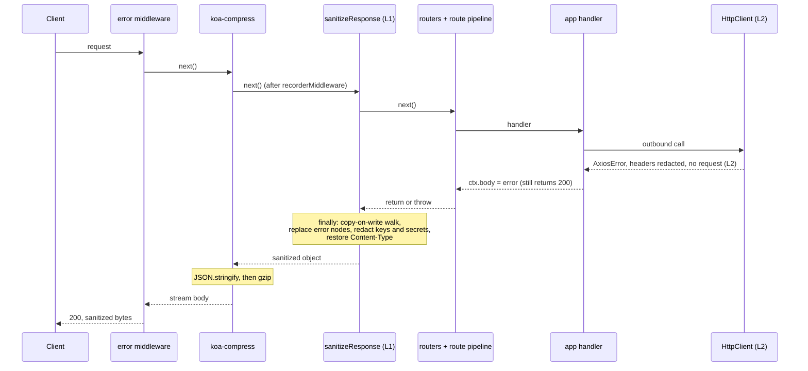

# Sanitize credential-bearing HTTP responses (two layers)

> **Status**: Draft (v2: merged with an independent review of v1)
> **Created**: 2026-11-06

## 1. Business Context

### Problem Statement

A VTEX IO Node app can catch an outbound HTTP failure and assign the raw error to the response body, then return normally: `catch (e) { ctx.body = e }`. On a public route this needs no authentication. The body is the Axios error serialized through `AxiosError.prototype.toJSON()`: `message`, `name`, `stack`, and `config`. `config.headers` carries the app credential (`proxy-authorization`, copied from `x-vtex-credential`) and other VTEX headers; the stack carries internal paths; agent options leak runtime internals. A caller can trigger the failure with a malformed query parameter and receive a fresh app token on every request.

The existing global handler (`src/service/worker/runtime/http/middlewares/error.ts`) cannot see this. It only runs inside `try { await next() } catch`, and a handler that swallows the exception returns on the success path. On the way out, `koa-compress` (3.x) runs `ctx.body = JSON.stringify(body)`, which calls the error's `toJSON()` and writes `config.headers` into the response.

### Verified runtime facts

| Fact | Evidence |
|---|---|
| The pod is the `service-node` image: a Go binary downloads the bundle to `./service` and runs `node lib/index.js` with `NODE_ENV=production`. | `service-runtime-node/main.go`, `Dockerfile` |
| `lib/index.js` calls `smartRequire('@vtex/api').startApp()`. Without `VTEX_APP_LINK` it resolves the runtime's copy; with it, the developer's copy (`appPath`). | `src/index.ts`, `src/smartRequire.ts` |
| **Which image runs an app depends on its `manifest.json` `builders.node` major.** `6.x` runs `IO_SERVICE_NODE_V6` (6.42.4), built from the `6.x` branch of `service-runtime-node`, which pins **`@vtex/api` 6.52.1** (Node 16, axios `^0.30.1` in `node-vtex-api`'s `6.x`). `7.x` runs `IO_SERVICE_NODE_V7` (7.8.0), built from `master`, which pins `@vtex/api` 7.6.0 (Node 20, axios `^1.8.4`). `V4` and `V5` pin `@vtex/api ^3.x`. | `charts/io/platform/values.yaml` (lines 44–63); `package.json` on each branch |
| The app's own `import … from '@vtex/api'` resolves to the image's copy when the bundle does not ship one. The Dockerfile links `/usr/local/node_modules/@vtex` at `/usr/local/app/node_modules/@vtex`, and the bundle lives at `/usr/local/app/service/src/node/`. | `Dockerfile`, `src/service/loaders.ts` |
| `builder-hub` pins `@vtex/api` only for typings (`pinnedDependencies.ts`) and no builder step removes it from `dependencies`. The 2020 changelog says "Uses @vtex/api from runtime for node 6.x". So an app that lists `@vtex/api` under `dependencies` may carry its own copy. Not verified. | `builder-hub/CHANGELOG.md`, `node/request/handlers/pinnedDependencies.ts` |
| A leaked response proves the image's client served the call: the stack frames sit under `/usr/local/app/node_modules/axios`, and `httpAgent` shows `freeSocketTimeout 30000`, `maxFreeSockets 256`, `socketActiveTTL 120000`, the values in `src/HttpClient/agents.ts`. | captured response; `agents.ts` |
| Token source: `prepareHandlerCtx` sets `ctx.vtex.authToken` from `x-vtex-credential`. `ExternalClient` puts it in `Proxy-Authorization`. `defaultsMiddleware` lower-cases header names. | `utils/context.ts`, `clients/external/ExternalClient.ts`, `HttpClient/middlewares/request/index.ts` |
| Koa pipeline on both lines: `error → … → compress() → recorderMiddleware → public router → private router → route pipeline → app handlers`. GraphQL is built on `createPrivateHttpRoute`. | `src/service/worker/index.ts` on `master` and `origin/6.x` |
| The child Node process receives only an env whitelist (`runner/command.go` `envWhitelist`) plus `envVars` in `service-runtime-node/main.go`. A new env var reaches the app only if added there. | `service-runtime-base/runner/command.go`, `main.go` |

### Goals

- No HTTP response of a production Node app contains the app token, credential headers of upstream calls, Node `request`/agent objects, or a stack.
- The fix reaches installed apps without rebuilding them, on every runtime line that serves them, through a runtime release.
- Preserve what the app returns: remove only sensitive fields. No status or general shape changes.
- Make remaining leaks visible so owners can be notified.

### User Stories

#### US-1: Caught HTTP-client error written to the body

- **Story**: As a platform operator, I want an error object assigned to `ctx.body` to leave the pod without credentials, agent internals, or a stack, so that a tenant app cannot leak the app token.
- **Acceptance Criteria**:
  - **Given** a route whose handler sets `ctx.body` to an Axios error and does not throw, **when** the response is produced in a non-linked runtime, **then** `JSON.stringify` of the body contains no token, `config`, `request`, `httpAgent`/`httpsAgent`, or `stack`, keeps `name`, `message`, `code`, `status`, and `ctx.status` is unchanged.
  - **Given** `ctx.body = e.toJSON()` (a plain object with `config.headers`), **when** the response is produced, **then** the result is the same.
  - **Given** a runtime where the code applies and `VTEX_APP_LINK` is set, **when** the response is produced, **then** `stack` stays and tokens and credential headers are still redacted.

#### US-2: Nested and hand-built bodies

- **Story**: As a platform operator, I want errors and credentials removed at any depth of an object body, so that `{ error: e }`, `[e]`, `{ errors: [{ extensions: { exception: e } }] }`, and hand-copied header objects are covered.
- **Acceptance Criteria**:
  - **Given** an error-like node or a credential-header key at any depth, **when** the response is produced, **then** the error is replaced by its safe form and the header value is `[REDACTED]`.
  - **Given** a string value or a top-level string body that contains a known secret of 20 or more characters, **when** the response is produced, **then** each occurrence becomes `[REDACTED]` and the rest is unchanged.
  - **Given** `{ token: 'abc', authorization: { status: 'approved' } }` or `authorization: 'approved'`, **when** the response is produced, **then** the body is unchanged. Only `authorization` values that start with `Bearer` or `Basic` are redacted.

#### US-3: Ordinary responses and thrown errors keep working

- **Story**: As an app developer, I want unaffected responses and thrown errors to behave as before.
- **Acceptance Criteria**:
  - **Given** a body with no error-like node, credential key, or secret, **when** the handler returns, **then** `ctx.body` is the same reference and the `Content-Type` header is unchanged (including a non-default JSON type).
  - **Given** a handler that sets `ctx.body = e` and then throws, **when** the request ends, **then** the body is sanitized and the exception still reaches the `error` middleware.
  - **Given** a body that is `Buffer`, a stream, or `null`, **when** the response is produced, **then** it is untouched.

#### US-4: The error is safe at its origin

- **Story**: As a platform operator, I want the error to reach app code without credentials, so that logging it, persisting it, or putting it in an event cannot leak them.
- **Acceptance Criteria**:
  - **Given** an `HttpClient` call that fails with HTTP 400, **when** the app catches the error, **then** `config.headers['proxy-authorization']` is `[REDACTED]`, `request` and `response.request` are `undefined`, and `response.status` and `response.data` are intact.
  - **Given** a call that fails with 503 twice and then succeeds, **when** retries run, **then** every attempt sent the real header and the call succeeds.

#### US-5: Operability

- **Story**: As an on-call engineer, I want to see which apps trigger redactions and to switch the response layer off.
- **Acceptance Criteria**:
  - **Given** a redaction, **when** it happens, **then** a warn log and a counter record the layer, kind, and route id, and never the value or the body.
  - **Given** `VTEX_IO_RESPONSE_SANITIZER=off`, **when** a request is served, **then** the response layer does nothing. The origin layer has no switch.
  - **Given** an exception inside the sanitizer, **when** it occurs, **then** the response is served unchanged and a `failed` counter is incremented (fail-open).

### Key Scenarios

| Scenario | Pre-conditions | Steps | Expected Result |
|---|---|---|---|
| Caught error, gzip client | Non-linked. Handler sets `ctx.body = axiosError`, returns 200. | `GET` with `Accept-Encoding: gzip`. | Plain body without token, `config`, `request`, agents, `stack`; has `name`, `message`, `code`, `status`. Status 200. Gzip applied. |
| Nested shapes | Body is `{ error: e }`, `[e]`, or `{ errors: [{ extensions: { exception: e } }] }`. | Return normally. | Every error node replaced by its safe form. Sibling fields intact. |
| Stringified error | `ctx.body = JSON.stringify(e)`. | Return normally. | Known token replaced by `[REDACTED]`. Stack and third-party headers in the string remain (gap; the origin layer already redacted the headers). |
| Throw after body set | Handler sets `ctx.body = e`, then throws. | Request ends. | Body sanitized in `finally`; the `error` middleware still handles the exception and keeps that body. |
| Legitimate lookalikes | `{ token: 'abc', authorization: { status: 'approved' } }`, 5,000-product list. | Return normally. | Same reference, deep-equal, same `Content-Type`. |
| Credential key outside an error | `{ headers: { 'proxy-authorization': 'x' }, auth: 'Bearer abc' }`. | Return normally. | `proxy-authorization` value and the Bearer value become `[REDACTED]`. |
| Frozen or shared body | App returns a frozen or module-cached object holding a token. | Two requests. | The app's object is not mutated; each response is sanitized. |
| Circular or huge body | Cycle, depth over 32, or over the node limit. | Return normally. | No hang, no throw. A `truncated` counter on limit hits. |
| No `ctx.vtex` | Unknown route, router 404. | Request with `x-vtex-credential` set. | Token still redacted: read from the header. |
| Kill switch | `VTEX_IO_RESPONSE_SANITIZER=off`. | Any request. | Response layer does nothing. |
| GraphQL | A resolver returns an Axios error inside a JSON scalar. | `POST` the GraphQL route. | Response sanitized. |
| HttpClient failure (origin layer) | Upstream answers 400. | App catches and serializes or persists the error. | `config.headers` redacted, no `request`; `status` and `data` intact. |
| HttpClient retry | Upstream fails twice with 503, then 200. | Call through `HttpClient`. | All attempts carry the real header; the call succeeds. |
| App ships its own `@vtex/api` | `@vtex/api` listed under `dependencies`. | Same failure as above. | Response layer applies; origin layer does not. |

### Functional Requirements

Response layer (Layer 1):

- One Koa middleware at app level, registered after `recorderMiddleware` and before the routers (inside `compress()`), covering public, private, GraphQL, and built-in routes.
- `try { await next() } finally { sanitizeCtxBody(ctx) }`. The sanitizer never throws and never changes `ctx.status`.
- Walk object and array bodies recursively with copy-on-write. Return the original reference when nothing changed.
- Replace error-like nodes with their safe form. Redact credential-header keys and known secrets by value. Top-level strings only get secret replacement.
- Save and restore `Content-Type` around the reassignment of `ctx.body`.
- Bounded work: seen-set for cycles, depth 32, node limit (default 200,000).
- Skip `null`, `Buffer`, and streams (`typeof body.pipe === 'function'`).

Origin layer (Layer 2):

- In `requestMiddleware` (`src/HttpClient/middlewares/request/index.ts`), wrap `http.request` and throw `sanitizeHttpClientError(err)`.
- Redact sensitive header values on `err.config.headers` and `err.config.params`, keeping the keys. Delete `err.request` and `err.response.request`.
- Do not touch `stack`, `message`, `code`, `response.status`, or `response.data`.
- Must behave the same on axios `0.30.x` (plain headers object) and `1.x` (`AxiosHeaders`).

Shared:

- One exported `SENSITIVE_HEADER_KEYS` constant. The thrown-error path in `cleanError` (`src/utils/error.ts`) uses it too, replacing its three hard-coded names.
- No API newer than Node 16: the `6.x` line ships on Node 16.20.2.

### Non-Functional Requirements

- Layer 1 costs one O(body) walk without allocating a serialized string. Measure p50/p99 in the Developers cluster before widening (see Verification).
- Never log or count the redacted value or the body.
- Metric: `vtex_io_credential_sanitizer_total{layer, kind, route_id}` with `layer` in `response|http_client` and `kind` in `error_object|app_token|header_key|truncated|failed`. Needs the metrics review required by the runtime repository (see Open Questions).
- Warn log: `{ message: 'credential-sanitizer: sensitive data removed from response', routeId, kinds, count }`, through `ctx.vtex.logger` when present, otherwise the process-level logger.

### Out of Scope

- Fixing the tenant app. The owner still owns authentication and input validation for that route.
- Redacting at Janus or the router (rejected earlier for proxy cost).
- Changing status codes, or turning a 200 error into a 5xx.
- Redacting `adminUserAuthToken`, `storeUserAuthToken`, `sessionToken` in v2 default behavior (see Open Questions).
- Event handlers (they answer 204) and bytes written directly to `ctx.res`.
- Revoking tokens already captured.
- Parsing top-level string bodies. Only known secrets are replaced there.
- Linked apps: with `VTEX_APP_LINK` set the entrypoint loads the developer's `@vtex/api`.
- Apps that bring their own axios or `node-fetch`: only Layer 1 applies.
- Runtime lines `V4`/`V5` unless the decision in Open Questions says otherwise.

---

## 2. Arch Decisions

### Proposed Solution

Two independent layers, released together on each runtime line that serves apps:

1. **Layer 1, response sanitizer**: an app-level Koa middleware that cleans `ctx.body` on the way out, before `compress()` serializes it.
2. **Layer 2, origin hardening**: `HttpClient` redacts credentials on the error before app code sees it.

Layer 1 closes the incident class (any app that writes an error or credential into the response). Layer 2 keeps the secret out of logs, Master Data documents, events, and GraphQL fields that the app fills from the error.

### Architecture Overview



`koa-compress` 3.x does `if (isJSON(body)) body = ctx.body = JSON.stringify(body)` and then swaps in a gzip stream. Registered after `compress()`, the sanitizer still sees the original object. `error` (outermost) would see the stream.

### Alternatives Considered

| Alternative | Pros | Cons | Verdict |
|---|---|---|---|
| Extend only the global `error` middleware | Reuses `cleanError` | Runs only on throws; sits outside `compress()` | Rejected |
| Sanitizer at the outermost position | Would see thrown-error bodies | Sees the gzip stream; thrown errors are already cleaned | Rejected |
| Sanitizer inside each route pipeline, before `...middlewares` (v1) | Close to the handlers | Two copies to keep in sync; misses built-in and 404 routes; `ctx.vtex` required; needs a separate answer for the throw path | Superseded by app-level placement |
| Redact in `HttpClient` only | Fixes the source | Does not cover hand-built bodies, apps with their own `@vtex/api`, or other clients | Accepted as Layer 2, with Layer 1 |
| Override `toJSON` on the error | Smaller serialized error | Changes the object apps may inspect; Layer 1 already drops `config` from responses | Rejected; redact in place and keep keys |
| In-place mutation of the body | No reassignment; fewer allocations | Mutates app-owned objects (cached, frozen, shared across requests); a frozen object throws, and fail-open then leaks | Rejected; copy-on-write |
| `JSON.stringify` the body and search the text | Simple | Calls the error's `toJSON()` again, re-creating the leak shape; extra allocation | Rejected |
| Redact `token`/`auth` keys generically | Broader | Breaks legitimate payloads | Rejected; only unambiguous header names |
| Turn an error body with status 200 into 5xx | Visible failure | Changes the app contract and caching | Rejected |

### Risks & Mitigations

| Risk | Impact | Likelihood | Mitigation |
|---|---|---|---|
| **Fix lands only on `master`; the affected apps run `V6`, built from the `6.x` branch** | High: the leak stays live | High if unplanned | Backport both layers to `node-vtex-api` `6.x` and release; bump `service-runtime-node` `6.x`; update `IO_SERVICE_NODE_V6` and `V7` (Decision 5) |
| axios `0.30` and `1.x` differ (headers shape, `toJSON`) | Layer 2 or tests pass on one line only | Medium | Run the same tests on both lines; construct errors with the real axios of each line |
| Reassigning `ctx.body` resets `Content-Type` (Koa forces `application/json` for object bodies; to verify) | Behavior change for custom JSON types | Medium | Save and restore the header; add a test |
| Tree walk cost on large bodies | Latency | Medium | Copy-on-write, depth and node caps, kill switch; measure in Developers first |
| App returns `ctx.vtex.authToken` on purpose | Breaks that app | Low | Intended; the metric names the app so owners can be told |
| Substring match on a secret of 20+ characters | False positive | Very low | Length floor; JWT-sized secrets |
| Body is a string holding a serialized error | Stack and third-party headers remain | Medium | Known gap; Layer 2 already redacted headers at origin |
| App has its own `@vtex/api` or axios | Layer 2 does not apply | Medium | Layer 1 still removes the app token by value |
| Sanitizer bug | Dropped or corrupted responses | Low | Fail-open, `failed` counter and alert, kill switch for Layer 1 |
| Kill switch unreachable in the pod | Cannot disable Layer 1 without a rollback | Medium | Add the env var to `envVars` in `service-runtime-node/main.go` and set it in the app-operator config |
| Layer 2 mutates `err.config` that something reuses | Wrong headers on a later attempt | Low | Redaction runs only on the final rejection; test that `response.config` is the same object and that retries see the real header |

### Key Decisions

#### Decision 1: App-level placement inside `compress()`, with `try/finally`

- **Status**: Accepted (replaces the per-route-pipeline placement of v1)
- **Context**: One middleware must cover public, private, GraphQL, and built-in routes, run before serialization, and still act when the handler set `ctx.body` and then threw. `error` keeps that body (`ctx.body = ctx.body || err`).
- **Decision**: `.use(sanitizeResponse)` right after `.use(recorderMiddleware)` in `startWorker`. Read the credential from `ctx.get('x-vtex-credential')` and from `ctx.vtex?.authToken`.
- **Consequences**: One registration. Routes without `ctx.vtex` are covered. The thrown-error body that `error` itself builds is outside this layer; it still goes through `cleanError`.

#### Decision 2: Preserve status and shape; sanitize with copy-on-write

- **Status**: Accepted
- **Context**: Apps may return errors with 200 on purpose, and may hold bodies that are frozen or shared.
- **Decision**: Never change `ctx.status`. Rebuild only the paths that change. Restore `Content-Type` after reassigning. Keep `message`, `name`, `code`, `status`, `level`, and `response.status`/`response.data`.
- **Consequences**: Unchanged bodies keep their reference. App-owned objects are never mutated.

#### Decision 3: Detection and redaction rules

- **Status**: Accepted
- **Context**: Errors arrive as `Error` instances, as `toJSON()` output, or hand-built objects.
- **Decision**: In order, for each node:
  1. **Error-like**: `instanceof Error`, or `isAxiosError === true`, or (`config` is an object with an object `headers`), or (`stack` and `message` are strings). Replace by `toSafeError(node)`, then walk the result with rules 2 to 4 (so `response.data` is checked too).
  2. **Header key**: lower-cased key in `SENSITIVE_HEADER_KEYS` with a string value becomes `[REDACTED]`: `proxy-authorization`, `vtexidclientautcookie`, `x-vtex-credential`, `x-vtex-api-apptoken`, `x-vtex-api-appkey`, `x-vtex-session`, `cookie`, `set-cookie`; and `authorization` only when the value matches `/^(bearer|basic)\s/i`.
  3. **Secret by value**: a string containing a known secret gets each occurrence replaced.
  4. **Container**: recurse into own enumerable entries of objects and arrays.
- **Consequences**: `toSafeError` is `cleanError(err)` minus `config`, `request`, `httpAgent`, `httpsAgent`, minus `stack` when not linked, with `response` reduced to `status`, `statusText`, `data`. Note `statusText` is not in `PICKED_AXIOS_PROPS`, so `cleanError` already drops it; read it from the original error or add it to that list.

#### Decision 4: Origin hardening in `requestMiddleware`

- **Status**: Accepted
- **Context**: The retry interceptor (`exponentialBackoff.ts`) is an axios response interceptor that calls `http(config)` internally. `requestMiddleware` only sees the final rejection.
- **Decision**: Wrap the request in `try/catch` and rethrow `sanitizeHttpClientError(err)`. Redact header and param values but keep keys. Use `headers.set` when it exists (`AxiosHeaders`), assignment otherwise.
- **Consequences**: App code that inspects header names keeps working. The tracing `ErrorReport` interceptor runs before this catch and is not covered. Before merging, check that `metrics.ts`, `tracing.ts`, `notFound.ts`, `cache.ts`, `inflight.ts`, `memoization.ts`, and `utils/retry.ts` do not read `err.request` or `err.config.headers` after this point.

#### Decision 5: Deliver on every runtime line that serves apps

- **Status**: Accepted (corrects v1, which targeted only `master` and `IO_SERVICE_NODE_V6`)
- **Context**: `V6` is built from the `6.x` branch with `@vtex/api` 6.52.1 and axios 0.30; `V7` is built from `master` with `@vtex/api` 7.6.0 and axios 1.x. An app's manifest chooses the line. The `6.x` line has the same pipeline shape (`error … compress, recorderMiddleware`), the same `requestMiddleware`, and the same `cleanError`.
- **Decision**: Implement on `master`, then backport to `node-vtex-api` `6.x`. Release each. Bump `@vtex/api` in `service-runtime-node` on `master` (image `V7`) and on `6.x` (image `V6`, currently 6.52.1). Update both chart values. Decide `V4`/`V5` from an inventory of installed apps by builder major.
- **Consequences**: Two releases, two images, two chart edits, two rollouts. Acceptance runs on both lines.

#### Decision 6: Observability and kill switch

- **Status**: Accepted, subject to review (Open Questions 1 and 3)
- **Context**: The runtime repository requires review for custom Prometheus metrics. The sanitizer needs a way to list leaking apps and to be disabled.
- **Decision**: Counter and warn log as above. `VTEX_IO_RESPONSE_SANITIZER=off` disables Layer 1 only. Add the variable to `envVars` in `service-runtime-node/main.go` on each line.
- **Consequences**: A Go change and image rebuild per line, which the release needs anyway.

### Open Questions

1. **Metric or log only?** The runtime repository forbids new custom Prometheus metrics without review. Options: get the review, reuse the instruments in `src/service/tracing/metrics/instruments.ts`, or ship the warn log first and build the dashboard on logs.
2. **`V4`/`V5` images** pin `@vtex/api ^3.x`. Do they still serve apps that matter? If yes, a Layer 1 backport is needed there; if not, record the accepted risk.
3. **Can the app-operator set `VTEX_IO_RESPONSE_SANITIZER` on all pods?** If not, the switch is an image rollback.
4. **Should the secret list include `adminUserAuthToken`, `storeUserAuthToken`, `sessionToken`?** v2 default: no, since the caller already holds them. Counter-point: a public route cached by a CDN could serve one user's echoed token to another. It costs one more `includes` per string; decide before implementation.
5. **Fail-open or fail-closed** on a sanitizer exception. Recommendation: fail-open with the `failed` counter and an alert.
6. **Versions.** Patch bumps are proposed (`7.6.0` to `7.6.1` on `master`; next patch on `6.x`; next patch of each runtime image). Confirm with the release owners.
7. **Do apps that list `@vtex/api` under `dependencies` get their own copy?** Not verified; build one and inspect `service/` and `node_modules` before relying on Layer 2 for them.

### Implementation Plan

1. `node-vtex-api` `master`: add `src/utils/responseSanitizer.ts` (pure functions), `src/service/worker/runtime/http/middlewares/sanitizeResponse.ts`, `sanitizeHttpClientError` and `SENSITIVE_HEADER_KEYS` in `src/utils/error.ts`, and the `requestMiddleware` wrap. Register the middleware in `startWorker`. Tests as in section 4. Changelog entry under "Security".
2. Backport to `node-vtex-api` `6.x`; re-run the tests against axios `0.30.x`; keep to Node 16.
3. Release each line to npm.
4. `service-runtime-node` `master`: bump `@vtex/api`, add the env var to `envVars`, tag (image `V7`). Same on `6.x` (image `V6`).
5. `charts` `/io/platform/values.yaml`: update `IO_SERVICE_NODE_V7` and `IO_SERVICE_NODE_V6`; one PR per line.
6. Argo CD: sync with server-side apply, only the runtime resources, in order Developers, Admins, Stores. Run the Developers acceptance before moving on; watch the io-dash, the new counter, and pod restarts.
7. Rollback: revert the charts commit and sync. In an emergency, change the image in the app-operator config. `VTEX_IO_RESPONSE_SANITIZER=off` disables Layer 1 only.

---

## 3. Technical Contract

### Data Models

- **Error-like node**: as in Decision 3, rule 1.
- **`SENSITIVE_HEADER_KEYS`** (lower-case): `proxy-authorization`, `vtexidclientautcookie`, `x-vtex-credential`, `x-vtex-api-apptoken`, `x-vtex-api-appkey`, `x-vtex-session`, `cookie`, `set-cookie`, plus `authorization` under the Bearer/Basic condition.
- **Known secrets**: `ctx.get('x-vtex-credential')` and `ctx.vtex?.authToken`; strings of 20 or more characters; de-duplicated; longest first.
- **Redaction token**: `[REDACTED]`.
- **Limits**: depth 32; nodes `VTEX_IO_RESPONSE_SANITIZER_MAX_NODES`, default 200,000 (the env var is optional).
- **Kinds** (counter label): `error_object`, `app_token`, `header_key`, `truncated`, `failed`.

### Interfaces

```ts
// src/utils/responseSanitizer.ts (pure, testable without Koa)
export interface SanitizeOptions { secrets: string[]; linked: boolean; maxDepth: number; maxNodes: number }
export interface SanitizeResult<T> { value: T; changed: boolean; kinds: Set<string> }
export function sanitizeValue<T>(node: T, options: SanitizeOptions): SanitizeResult<T>
export function toSafeError(err: unknown, linked: boolean): Record<string, unknown>

// src/service/worker/runtime/http/middlewares/sanitizeResponse.ts
export async function sanitizeResponse(ctx: ServiceContext, next: () => Promise<void>): Promise<void>
// try { await next() } finally { sanitizeCtxBody(ctx) }  // never throws

// src/utils/error.ts
export const SENSITIVE_HEADER_KEYS: readonly string[]
export function sanitizeHttpClientError<T>(err: T): T
```

`sanitizeCtxBody(ctx)`:

1. Return if `VTEX_IO_RESPONSE_SANITIZER === 'off'`.
2. Return for `null`, `Buffer`, or streams.
3. Build the secret list.
4. String body: replace secrets; reassign if changed.
5. Object or array body: `sanitizeValue`; if `changed`, remember `Content-Type`, assign the new body, and restore the header.
6. On any internal throw, count `failed`, log, and return.
7. On change, count and log by `kinds`.

`sanitizeHttpClientError(err)`: non-objects return as-is. Redact sensitive header and param values on `err.config`, delete `err.request`, delete `err.response.request`, and leave `stack`, `message`, `code`, `response.status`, `response.data` alone.

### Integration Points

- `src/service/worker/index.ts`: register `sanitizeResponse` after `recorderMiddleware`.
- `src/HttpClient/middlewares/request/index.ts`: `requestMiddleware` catch.
- `src/utils/error.ts`: shared header list; `cleanError` uses it.
- `src/service/worker/runtime/http/middlewares/error.ts`: unchanged. It still handles thrown exceptions.
- `service-runtime-node/main.go`: add the env var to `envVars` (each line).
- `charts` `/io/platform/values.yaml`: `IO_SERVICE_NODE_V6`, `IO_SERVICE_NODE_V7`.

### Invariants & Constraints

- The sanitizer never throws and never changes `ctx.status`.
- A body with nothing to redact is returned as the same reference with the same `Content-Type`.
- App-owned objects are never mutated by Layer 1.
- Redaction values and bodies are never logged or counted.
- Outside link mode, no response body contains `stack`, `config`, `request`, `httpAgent`, or `httpsAgent` on an error-like node.
- No known secret of 20 or more characters appears in any string of an object, array, or string body.
- Layer 2 changes only the final rejection; retries see the original headers.
- Code on the `6.x` line uses nothing newer than Node 16.

---

## 4. Verification

**Final criterion**: a published, installed (not linked) app with `catch (e) { ctx.body = e }` around a failing `ExternalClient` call answers 200 with no token, `config`, `request`, or `stack`, and with `message`, `name`, `code`, `status` present. Run it on a node-6.x app (image `V6`) and a node-7.x app (image `V7`).

Unit (jest, following `timings.test.ts`), on both lines:

- A real axios error (constructed with the axios of that line) with `config.headers['proxy-authorization'] = TOKEN` as `ctx.body`: no token, `config`, `request`, agents, or `stack`; keeps `name`, `message`, `code`, `status`.
- `{ error: e }`, `[e]`, `{ data: null, errors: [{ message, extensions: { exception: e } }] }`, `e.toJSON()`, `JSON.stringify(e)` (string).
- Lookalikes unchanged with the same reference: `{ token, authorization: { status } }`, 5,000-item list, plain string, `Buffer`, stream.
- `{ headers: { 'proxy-authorization': 'x' } }` redacted; `authorization: 'Bearer abc'` redacted; `authorization: 'approved'` kept.
- Circular body; frozen body; depth and node limits (counter, no throw).
- Handler sets `ctx.body = e` then throws: body sanitized, exception reaches `error`.
- `Content-Type: application/vnd.api+json` is preserved.
- `VTEX_APP_LINK` set: `stack` kept, token and headers still removed. Kill switch `off`: untouched.
- Layer 2: local server returns 400 (`proxy-authorization` redacted, `request` and `response.request` undefined, `status` and `data` intact); two 503s then 200 (all attempts carry the real header); `response.config === config`; `GraphQLClient` inherits.
- GraphQL: a resolver returns a JSON scalar containing an error.

Integration (supertest, as in `service-runtime-node/src/__tests__`): a mock service with a route that calls an `ExternalClient` pointed at a local server returning 400 and sets `ctx.body = e`; the response has `message` and `name` and no token, `config`, or `stack`; repeat with `Accept-Encoding: gzip`.

Real environment (Developers cluster, new images): reproduce the incident request against the test app; compare p50/p99 runtime latency before and after on an ordinary app; confirm the counter shows `app_token` for the test app.
