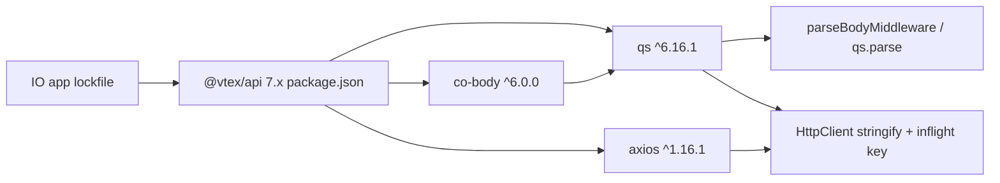

# 7.x floors for `qs` and `axios` in `@vtex/api`

> **Status**: Done
> **Created**: 2026-11-19
> **Jira**: [XTNSNS-2663](https://vtex-dev.atlassian.net/browse/XTNSNS-2663), [VSC-1338745](https://vtex-dev.atlassian.net/browse/VSC-1338745), [VSC-1411174](https://vtex-dev.atlassian.net/browse/VSC-1411174)
> **Repository**: [vtex/node-vtex-api](https://github.com/vtex/node-vtex-api) (`master`, `@vtex/api` 7.x)
> **Reference**: [PR 816](https://github.com/vtex/node-vtex-api/pull/816) (6.x `qs` floor). This spec does not repeat that change.

## 1. Business Context

### Problem Statement

`@vtex/api@7.6.4` (`master`) still publishes dependency ranges that let a VTEX IO app resolve vulnerable releases of `qs` and `axios`. The customer report behind [VSC-1338745](https://vtex-dev.atlassian.net/browse/VSC-1338745) (TFG) and the reachable `qs` path in [VSC-1411174](https://vtex-dev.atlassian.net/browse/VSC-1411174) are closed for an app only when the published `package.json` of `@vtex/api` refuses those versions. The library `yarn.lock` is not installed by consumers.

On `master` today:

| Package | Declared range | Resolved in this repo | Floor this spec requires | Why |
|---|---|---|---|---|
| `qs` | `^6.5.1` | `6.9.1` (direct dep and `co-body`'s `qs@^6.5.2`) | `^6.16.1` | `6.15.2` still matches GHSA-x5fp-wj9c-mxmx, GHSA-4mjr-xmp4-gh2g and GHSA-6pq8-jhm2-2vcw. `6.16.1` is the first release clear of them. PR 816 already uses this floor on 6.x. |
| `axios` | `^1.8.4` | `1.8.4` | `^1.16.1` | SSRF via `NO_PROXY` hostname normalization bypass (CWE-918). The 6.x line stays on axios `0.30.x` and is not part of this change. |

`co-body@^6.0.0` parses `application/x-www-form-urlencoded` bodies with `qs.parse`. `parseBodyMiddleware` calls `co-body` on inbound event bodies. `HttpClient` calls `qs.stringify` with `arrayFormat: 'repeat'` for query params and for the single-flight key.

### Goals

- Publish a 7.x patch whose `package.json` declares `qs@^6.16.1` and `axios@^1.16.1`.
- A clean install of that patch resolves one `qs >= 6.16.1` for the SDK and for `co-body`, and `axios >= 1.16.1`.
- Query serialization (`arrayFormat: 'repeat'`), single-flight keys, JSON body parsing, and short form-urlencoded bodies stay as they are on `7.6.4`.
- The `qs` shape change for bracket arrays longer than 20 items is covered by a test, so it is an explicit, reviewed behavior rather than a silent lockfile bump.

### User Stories

#### US-1: Raise the `qs` floor on `@vtex/api@7.x`

- **Story**: As a maintainer of a VTEX IO app on `@vtex/api@7.x`, I want the published SDK to require `qs@^6.16.1`, so that refreshing the app lockfile drops the vulnerable `qs` used by the SDK and by `co-body`.
- **Acceptance Criteria**:
  - **Given** `@vtex/api@7.x` declares `"qs": "^6.16.1"`, **when** a consumer installs that version without a stale `qs` entry, **then** the direct `qs` dependency and `co-body`'s `qs@^6.5.2` resolve to a single version `>= 6.16.1`.
  - **Given** an `HttpClient` request whose `params` contain arrays, nested objects, or no params, **when** `paramsSerializer` and `inflightUrlWithQuery` stringify them with `arrayFormat: 'repeat'`, **then** the query string matches the string produced on `7.6.4` with `qs@6.9.1`.
  - **Given** an inbound event with a valid JSON body or a form-urlencoded body of at most 20 repeated bracket values, **when** `parseBodyMiddleware` runs, **then** `ctx.state.body` is populated and `next()` is called.
  - **Given** an inbound event with invalid JSON, **when** `parseBodyMiddleware` runs, **then** the response status is `500`, the handler is not called, and the error is logged once.

#### US-2: Raise the `axios` floor on `@vtex/api@7.x`

- **Story**: As a maintainer of a VTEX IO service on `@vtex/api@7.x`, I want the published SDK to require `axios@^1.16.1`, so that the `NO_PROXY` bypass is no longer an allowed resolution, without changing the `HttpClient` call contract.
- **Acceptance Criteria**:
  - **Given** `@vtex/api@7.x` declares `"axios": "^1.16.1"`, **when** a consumer installs that version, **then** the resolved `axios` is `>= 1.16.1`.
  - **Given** `HttpClient` is configured with `maxRedirects: 0` and `validateStatus` accepting only `2xx`, **when** the upstream answers `2xx`, **then** the call resolves; **when** it answers `4xx` or `5xx`, **then** the call rejects; **when** it answers `301` or `302`, **then** the redirect is not followed.
  - **Given** `axios >= 1.16.0` counts TCP connect and time-to-response-headers inside `timeout` when `maxRedirects` is `0`, **when** connect and headers finish inside the configured timeout, **then** the call succeeds; **when** either exceeds the timeout, **then** the call rejects with a timeout error.
  - **Given** a retryable failure and `retries > 0`, **when** the exponential backoff interceptor retries, **then** the configured agent is kept and cancellation still rejects the in-flight call.

#### US-3: Record the bracket-array shape change

- **Story**: As a reviewer of this release, I want a test that pins the `qs` 6.14.1+ parsing change, so that app owners can be told which form bodies change shape.
- **Acceptance Criteria**:
  - **Given** a form-urlencoded body with more than 20 `a[]` values, **when** `parseBodyMiddleware` parses it with the floored `qs`, **then** `ctx.state.body.a` is an indexed object, which is the `qs >= 6.14.1` result. On `qs@6.9.1` the same body produced an array.

### Key Scenarios

| Scenario | Pre-conditions | Steps | Expected Result |
|---|---|---|---|
| Happy path — consumer resolution | A clean app installs the new 7.x patch | Inspect `qs` and `axios` with `yarn why` | One `qs >= 6.16.1` shared by `@vtex/api` and `co-body`; `axios >= 1.16.1` |
| Happy path — outbound query and single-flight | `HttpClient` with `paramsSerializer` and `inflightUrlWithQuery` | Send concurrent GETs with `{ fq: ['C:/1/2/', 'P:[0 TO 100]'] }` | Query string is `fq=C%3A%2F1%2F2%2F&fq=P%3A%5B0%20TO%20100%5D`; identical in-flight calls share one upstream request |
| Happy path — short form body | Event route, `Content-Type: application/x-www-form-urlencoded`, body `order.id=123&sku=10&sku=20` | `parseBodyMiddleware` | `ctx.state.body` is `{ order: { id: '123' }, sku: ['10', '20'] }` and `next()` runs |
| Error case — malformed JSON event | Event route, `Content-Type: application/json`, body is not JSON | `parseBodyMiddleware` | Status `500`, handler not called, one error log |
| Error case — axios timeout under `maxRedirects: 0` | `axios >= 1.16.1`, timeout shorter than connect or response headers | Call a local server that accepts late or delays headers | Call rejects with a timeout error; retries run only when `retries > 0` |
| Edge case — bracket array over `arrayLimit` | Form body with 21 or more `a[]` values | `parseBodyMiddleware` | `a` is an indexed object (`{ '0': ..., '21': ... }`), not an array |

### Functional Requirements

- Change the published `qs` range from `^6.5.1` to `^6.16.1`.
- Change the published `axios` range from `^1.8.4` to `^1.16.1`.
- Keep `co-body` at `^6.0.0`. Its `qs@^6.5.2` range is satisfied by `^6.16.1` and must dedupe to that copy.
- Keep `paramsSerializer` and `inflightUrlWithQuery` on `arrayFormat: 'repeat'`.
- Keep `maxRedirects: 0`, `validateStatus` for `2xx`, and `DEFAULT_TIMEOUT_MS` (`1000`).
- Add regression tests for the `qs` floor, query-string parity, event JSON and form parsing, the bracket-array shape change, and the axios timeout/redirect/retry behavior that changes at `1.16`.
- Add a `CHANGELOG` security entry for each floor.

### Non-Functional Requirements

- No public API change. Call signatures of `HttpClient`, `parseBodyMiddleware`, and the GraphQL JSON body parser stay the same.
- `yarn ci:build`, `yarn lint`, and the Jest suite pass on the branch. Failures that already reproduce on `origin/master` are called out in the PR and are not treated as regressions of this change.
- The two floors land as separate commits, `qs` first, so a failure can be attributed to one package.

### Out of Scope

- `protobufjs`. It is not a dependency of `@vtex/api`. The copy resolved at `7.5.0` enters through `@vtex/diagnostics-nodejs@0.2.0-io` (`@grpc/proto-loader@^7.2.5` and `@opentelemetry/otlp-transformer@^7.3.0`). The floor `^7.5.8` belongs in a new `-io` release of that library. This spec does not add a direct `protobufjs` dependency and does not change the `0.2.0-io` pin.
- Cookie masking in tracing spans ([VSC-1474798](https://vtex-dev.atlassian.net/browse/VSC-1474798)). It is not part of VSC-1338745. `cookie` stays on `INTERESTING_HEADERS`.
- Credential redaction of `HttpClient` errors and response bodies. That work is already in `7.6.4`.
- The 6.x line. PR 816 covers `qs` there. Axios stays on `0.30.x` on 6.x.
- The `qs@~6.5.2` copy pulled by the deprecated `request` package. `~6.5.2` cannot take `6.16.1`. It is not the `co-body` path.
- Publishing the npm release, bumping `service-runtime-node` or the builders, and notifying owners of apps with a pinned `@vtex/api`. Those follow this repository change. Apps keep their own lockfile until they upgrade.
- Reusing `feat/vsc-1338745-dependency-bumps`. That branch floors `qs` at `^6.15.2`, adds `protobufjs` to this package, and is based on an older `master` (`7.4.1`).

---

## 2. Arch Decisions

### Proposed Solution

Branch from current `master` (`7.6.4`, `ac0260f3`). Raise only the two published ranges this package controls, in two commits. Refresh `yarn.lock` with `yarn install` so this repo's own test install matches the floors. Port the `qs` regression suite from PR 816, dropping the assertion that axios stays on `0.30.x`. Extend the axios tests for the timeout behavior that starts at `1.16` when `maxRedirects` is `0`.

### Architecture Overview

`qs` has two production uses in this package:

- Outbound: `src/HttpClient/middlewares/request/index.ts` (`paramsSerializer`) and `src/HttpClient/middlewares/inflight.ts` (`inflightUrlWithQuery`). Both call `qs.stringify` with `arrayFormat: 'repeat'`. These advisories are about `qs.parse` and about one `stringify` option pair (`arrayFormat: 'comma'` with `encodeValuesOnly`). The `repeat` serializer is not that pair.
- Inbound: `src/service/worker/runtime/events/middlewares/body.ts` calls `co-body` on `ctx.req`. For `application/x-www-form-urlencoded`, `co-body` calls `qs.parse` on the raw body. That is the path VSC-1411174 treats as reachable. GraphQL (`src/service/worker/runtime/graphql/middlewares/query.ts`) uses `co-body`'s `json()` and does not call `qs.parse`.

`axios` is the transport of `HttpClient`. `defaultsMiddleware` sets `maxRedirects: 0`, a `2xx` `validateStatus`, and the `qs` `paramsSerializer`. `DEFAULT_TIMEOUT_MS` is `1000`.

### Alternatives Considered

| Alternative | Pros | Cons | Verdict |
|---|---|---|---|
| Floor `qs` at `^6.15.2`, as in the older spec | Matches the original sentence in VSC-1338745 | `npm audit` on 6.15.2 still reports GHSA-x5fp-wj9c-mxmx, GHSA-4mjr-xmp4-gh2g and GHSA-6pq8-jhm2-2vcw. PR 816 moved 6.x to `^6.16.1` for that reason | Rejected |
| Declare `protobufjs@^7.5.8` in this package | Would hoist a safe copy for apps that install `@vtex/api` | Leaves the vulnerable range inside `@vtex/diagnostics-nodejs@0.2.0-io` for every other consumer. The pin here is exact, so the durable fix is a new diagnostics `-io` release | Rejected for this spec |
| Bump only `yarn.lock` / `resolutions` | Fixes this repo's install | Consumers ignore the library lockfile and its `resolutions` | Rejected |
| Cherry-pick `feat/vsc-1338745-dependency-bumps` | Work already exists | Wrong `qs` floor, includes `protobufjs`, 88 commits behind current `master` | Rejected |

### Risks & Mitigations

| Risk | Impact | Likelihood | Mitigation |
|---|---|---|---|
| Form-urlencoded bodies with more than 20 `a[]` values become an indexed object instead of an array (`qs` 6.14.1+) | Medium. An event handler that expects an array can throw or skip items | Medium for apps that parse that shape; low for JSON and for `sku=1&sku=2` | Test pins the new shape. Release notes tell app owners. Short repeated keys and dotted keys stay arrays and nested objects |
| `axios >= 1.16` applies `timeout` to TCP connect and response headers when `maxRedirects` is `0` | Medium. A handshake that used to outlive the old timeout can now fail inside `DEFAULT_TIMEOUT_MS` | Medium | Tests cover a fast call, a slow header, and `timeout: 0`. Do not change the default timeout in this PR |
| An app lockfile keeps an older `qs` or `axios` until the app bumps `@vtex/api` | The CVE remains on that app | High until apps upgrade | The published range is the fix this repo can make. Runtime and app bumps stay out of scope and are named in the changelog |

### Key Decisions

#### Decision 1: `qs` floor is `^6.16.1`

- **Status**: Accepted
- **Context**: VSC-1338745 first asked for `>= 6.15.2`. A later audit on the 6.x line showed 6.15.2 still matches three advisories. PR 816 set the 6.x range to `^6.16.1` and the lockfile resolved `6.17.1`.
- **Decision**: The 7.x range is `^6.16.1`, same floor as 6.x. The resolved version may be newer than 6.16.1; the range is the contract.
- **Consequences**: 7.x and 6.x refuse the same `qs` releases. The array-limit shape change, which starts at 6.14.1, is included.

#### Decision 2: `axios` floor is `^1.16.1` and the client options stay

- **Status**: Accepted
- **Context**: The SSRF advisory is fixed in `axios >= 1.16.1`. This major already depends on axios 1.x. The 6.x line does not.
- **Decision**: Change the range from `^1.8.4` to `^1.16.1`. Leave `maxRedirects`, `validateStatus`, `paramsSerializer`, and `DEFAULT_TIMEOUT_MS` as they are.
- **Consequences**: Callers see the 1.16 timeout semantics. Tests have to cover them. No new HTTP client API.

#### Decision 3: `protobufjs` and cookie masking are not in this change

- **Status**: Accepted
- **Context**: `@vtex/api@7.6.4` pins `@vtex/diagnostics-nodejs@0.2.0-io` and does not depend on `protobufjs`. VSC-1474798 is a separate vulnerability about the `cookie` header in tracing spans.
- **Decision**: This branch does not add `protobufjs`, does not bump diagnostics, and does not edit `src/tracing/utils.ts`.
- **Consequences**: VSC-1338745 stays open for `protobufjs` until diagnostics publishes a `-io` build with `protobufjs@^7.5.8` and this package moves its pin. VSC-1474798 stays open.

#### Decision 4: Base is current `master`, two commits

- **Status**: Accepted
- **Context**: `feat/vsc-1338745-dependency-bumps` is stale and has the wrong scope.
- **Decision**: Branch from `origin/master` at `7.6.4`. Commit the `qs` floor, its lockfile hunk, and its tests first. Commit the `axios` floor second.
- **Consequences**: The PR diff is reviewable against the tree that production 7.x will ship from. The old feature branch is not merged.

### Implementation Plan

1. From `master`, set `"qs": "^6.16.1"` and run `yarn install`. Confirm `yarn why qs` shows `>= 6.16.1` for `qs@^6.16.1` and for `co-body`'s `qs@^6.5.2`. Leave `qs@~6.5.2` unresolved onto 6.16.
2. Add `src/HttpClient/middlewares/qsAndBodyParsing.test.ts` covering the floor, `repeat` serialization parity, single-flight, JSON and short form bodies, the malformed JSON 500, and the 21-item bracket array. Adapt the PR 816 file: it must not assert that axios is `0.30.x`.
3. Commit that step.
4. Set `"axios": "^1.16.1"` and run `yarn install`. Confirm the Jest `moduleNameMapper` for axios still points at the CJS build.
5. Add or extend tests for `2xx` / `4xx` / redirect-not-followed, timeout including connect and headers, `timeout: 0`, retry agent reuse, and cancellation.
6. Commit that step. Update `CHANGELOG.md` under `[Unreleased]` / `Security` for both floors.
7. Run `yarn ci:build`, `yarn lint`, and `yarn jest`. Pack the tarball and install it in an empty directory. Assert the consumer resolves `qs >= 6.16.1` and `axios >= 1.16.1`.

---

## 3. Technical Contract

### Data Models

No new domain types. The only observable data change is the value `co-body` stores on `ctx.state.body` for one body shape:

| Body | `qs@6.9.1` (current 7.6.4) | `qs >= 6.14.1` (this release) |
|---|---|---|
| `order.id=123&sku=10&sku=20` | `{ order: { id: '123' }, sku: ['10', '20'] }` | same |
| `a[]` repeated 21 times | `a` is an array of length 21 | `a` is an object with keys `'0'` … `'20'` |
| JSON object | parsed object | same |
| invalid JSON | throw, status 500 | same |

Outbound query strings produced with `arrayFormat: 'repeat'` are unchanged.

### Interfaces

Published dependency contract in `package.json`:

- `qs`: `^6.16.1` (was `^6.5.1`)
- `axios`: `^1.16.1` (was `^1.8.4`)
- `co-body`: `^6.0.0` (unchanged)
- `@vtex/diagnostics-nodejs`: `0.2.0-io` (unchanged)

Unchanged runtime options:

- `paramsSerializer`: `qs.stringify(params, { arrayFormat: 'repeat' })`
- `inflightUrlWithQuery`: `qs.stringify(params, { arrayFormat: 'repeat', addQueryPrefix: true })`
- `maxRedirects`: `0`
- `validateStatus`: `status >= 200 && status < 300`
- `DEFAULT_TIMEOUT_MS`: `1000`

`parseBodyMiddleware(ctx, next)` and the GraphQL `json()` parser keep their signatures.

### Integration Points

- `co-body@^6.0.0` selects `qs` from its own dependency range (`^6.5.2` at the version locked today). The SDK range must be a superset that npm and Yarn can hoist over that range.
- `HttpClient` is the only production caller of `axios` that this change configures. Direct `axios.request` in the GraphQL `@auth` directive must still accept a `2xx` from `vtexid` and license-manager.
- Consumers are VTEX IO apps on the `node` builder 7.x. They receive the new floors only after they depend on the published patch and refresh their lockfile.

### Invariants & Constraints

- The published range, not this repo's `yarn.lock`, is what an app install honors.
- `qs.stringify` with `arrayFormat: 'repeat'` for catalog-style `fq` params stays byte-identical to `7.6.4`.
- A form body with 20 or fewer repeated bracket values still parses as an array. The object shape applies only past `arrayLimit` (20).
- `protobufjs` remains transitive through `@vtex/diagnostics-nodejs@0.2.0-io` and is not constrained by this package.
- `cookie` remains an interesting tracing header.
- This change does not weaken the credential redaction already shipped in `7.6.4`.
